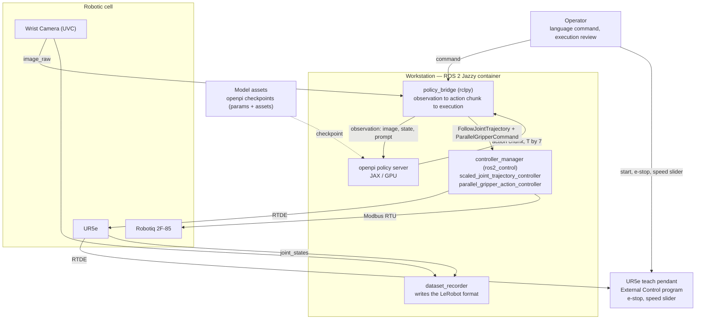
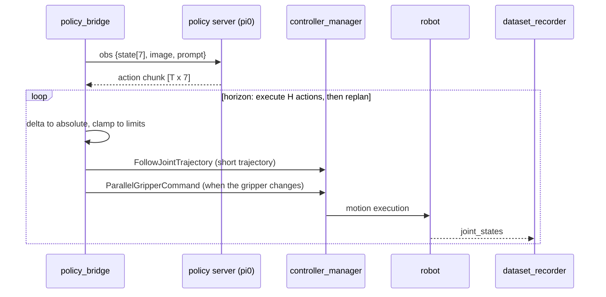
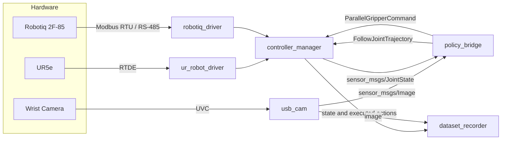
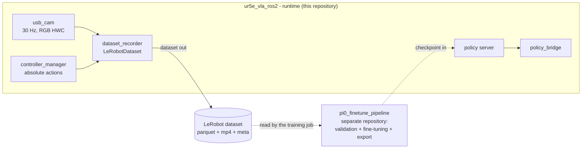

# Architecture Overview

Living document describing the architecture of the **UR5e + Robotiq 2F-85 + Wrist Camera + VLA (pi0)** stack.
Structure follows the [architecture.md](https://architecture.md/) specification.

> **Status:** this document describes the **target architecture**. Phases 0–2 (`.repos` workspace,
> hardware bring-up, a single `controller_manager`) are being implemented; phases 3–5 (data
> collection, inference, fine-tuning) are planned and marked in section 9. We keep this document
> up to date as the code evolves.

---

## 1. Project Structure

The `ur5e_vla_ros2` repository is the **master repository**: it contains only our own ROS 2
packages, environment configuration and documentation. All third-party drivers and libraries come
from the `ur5e_vla.repos` file and are imported into `/home/ws/src` (a Docker volume).

```
[repository] ur5e_vla_ros2/
├── .devcontainer/                  # container image + workspace bootstrap
│   ├── devcontainer.containerfile  # base ROS 2 Jazzy image + system dependencies
│   ├── devcontainer.json           # mounts, USB devices, volumes, ROS environment
│   └── setup-workspace.sh          # vcs import + colcon build + ownership fix
├── .github/workflows/              # CI: build from .repos + hardware-free tests
├── docs/                           # extended documentation
├── scripts/                        # helper scripts (bootstrap, teleop, demo, probe)
├── src/                            # OUR OWN ROS 2 packages (one repo, one build)
│   ├── ur5e_vla_description/       # URDF/xacro: UR5e + gripper on the flange
│   │   ├── urdf/                   #   robot description xacro + <ros2_control> block
│   │   ├── launch/                 #   launch producing robot_description
│   │   └── test/                   #   rendering and URDF validation tests
│   ├── ur5e_vla_control/           # ros2_control configuration + VLA nodes
│   │   ├── config/                 #   controllers.yaml, hardware parameters
│   │   ├── launch/                 #   launch of the whole stack
│   │   ├── ur5e_vla_control/       #   policy_bridge, dataset_recorder (phases 3–4)
│   │   └── test/                   #   unit, integration and HITL tests
│   └── ur5e_vla_bringup/           # a single launch that starts the entire cell
├── ur5e_vla.repos                  # dependency declaration (vcs import)
├── requirements-lerobot.txt         # pinned LeRobot (dataset format) for the recorder
├── README.md                       # project title (filled in at the end of the project)
└── ARCHITECTURE.md                 # this document

[ROS 2 workspace] /home/ws/
├── src/
│   ├── ur5e_vla_ros2/              # ← bind mount: our packages
│   ├── Universal_Robots_ROS2_Driver/    # ← vcs import (.repos)
│   ├── Universal_Robots_ROS2_Description/
│   ├── ros2_control/                    # ← vcs import (.repos, pin: jazzy)
│   ├── ros2_control_cmake/
│   ├── ros2_controllers/
│   ├── ros2_robotiq_gripper/            # ← vcs import (.repos)
│   ├── serial/                          # ← wSerial (tylerjw/serial)
│   └── usb_cam/
├── build/  install/  log/          # Docker volumes (survive container recreation)
```

**Split of responsibilities:**

| Directory | Owner | Contents |
|---|---|---|
| `src/*` (repo) | us | project code and configuration only |
| `/home/ws/src/*` (vcs) | dependencies | external code, pinned in `.repos` |
| `build/`, `install/`, `log/` | artefacts | git-ignored, mounted as volumes |

**Boundary between the two repositories:** this repository contains the **runtime only** —
drivers, control configuration, the robot description, and (in later phases) the policy bridge
and the dataset recorder. It contains **no training code and no fine-tuning workflow**.
Everything that turns a dataset into a checkpoint (dataset conversion and validation,
`LeRobotUR5DataConfig`, training, LoRA/full fine-tuning, checkpoint export) lives in the
separate `pi0_finetune_pipeline` repository, together with its own CI workflow.

The contract between the two repositories is deliberately narrow and consists of exactly three
things:

| Contract | Direction | Format |
|---|---|---|
| Dataset | runtime → `pi0_finetune_pipeline` | LeRobot (Parquet + MP4 + metadata) |
| Action convention | both | 7 dimensions: 6 arm joints (absolute in the dataset, deltas at runtime) + gripper (absolute) |
| Checkpoint | `pi0_finetune_pipeline` → runtime | openpi parameter directory |

---

## 2. High-Level System Diagram

System context (C4 Level 1): the operator, the workstation running the container, the robotic
cell and the model assets.



**System boundaries:** the only outward-facing interfaces are the UR pendant (RTDE channel to the
robot controller) and the RS-485 bus to the gripper. Communication with the model stays local
(WebSocket within the workstation).

---

## 3. Core Components

### 3.1 Third-party drivers (from `.repos`, no code of ours)

#### 3.1.1 `ur_robot_driver`

Name: UR5e RTDE driver

Description: Communication layer with the UR5e controller (ports 30002/30003/30004) and the
`controller_manager` for the arm. Provides the `sensor_msgs/JointState` stream, accepts motion
commands and reports the safety status.

Technologies: C++, ROS 2 Jazzy, `Universal_Robots_Client_Library`, RTDE,
`Universal_Robots_ROS2_Driver` @ `jazzy`.

Deployment: the `ur_control_node` process inside the workstation container; requires the
**External Control** program to be running on the pendant.

#### 3.1.2 `ur_controllers` — `ScaledJointTrajectoryController`

Name: Trajectory controller that honours the speed slider

Description: The `FollowJointTrajectory` controller for the 6 arm joints. Unlike the plain
`joint_trajectory_controller` it **scales velocity and acceleration according to the pendant
slider**, which lets the operator physically limit the pace of the robot.

Technologies: C++, `controller_interface`, `ur_controllers` (same repository as the driver).

Deployment: the `scaled_joint_trajectory_controller` instance inside the `controller_manager`.

#### 3.1.3 `robotiq_driver` — `RobotiqGripperHardwareInterface`

Name: Hardware plugin for the Robotiq 2F gripper

Description: A `hardware_interface::SystemInterface` implementation talking to the gripper over
Modbus RTU (slave 9 in upstream, **2** on our unit), 115200 8N1, through CDC-ACM. Handles
activation (`rACT`), position/status readout and motion commands (`rGTO`, `rPOS`, `rSPE`, `rFR`).

Technologies: C++, `hardware_interface`, wSerial (`tylerjw/serial` @ `ros2`),
`PickNikRobotics/ros2_robotiq_gripper` @ `main`.

Deployment: the plugin is loaded by `pluginlib` inside the `controller_manager`; it exports a
`position` command interface plus `position`/`velocity` state interfaces for the
`robotiq_85_left_knuckle_joint`, and the `reactivate_gripper_*` GPIO interfaces.

> **Hardware quirk:** this particular gripper answers on Modbus slave address **2**, not the
> default **9** (see section 8.4). Upstream does not expose that parameter in its xacro, so we
> require our own `<ros2_control>` block.

> **Upstream limitation:** the plugin never updates the `velocity` state interface (it is
> initialised to 0 and left there). Consequences: the gripper's velocity feedback is always 0,
> and any controller that watches for a stall (including
> `parallel_gripper_action_controller`) immediately reports `stalled: true`. The **position**
> feedback is the only trustworthy signal — never treat the action result as "the motion has
> finished".

#### 3.1.4 `parallel_gripper_action_controller`

Name: Gripper action controller

Description: Exposes the `control_msgs/action/ParallelGripperCommand` action for the gripper —
the canonical closing/opening interface in `ros2_control`. Replaces the classic
`gripper_controllers` (same purpose, newer implementation). The action carries a
`sensor_msgs/JointState` as its command (joint names, target positions, optional effort), not
a plain position number:

```bash
ros2 action send_goal /robotiq_gripper_controller/gripper_cmd \
  control_msgs/action/ParallelGripperCommand \
  "{command: {name: [robotiq_85_left_knuckle_joint], position: [0.79], effort: [50.0]}}"
```

Technologies: C++, `controller_interface`, `control_msgs`, `ros2_controllers` @ `jazzy`.

Deployment: the `robotiq_gripper_controller` instance inside the `controller_manager`.

#### 3.1.5 `usb_cam`

Name: UVC camera driver

Description: Reads frames from the Wrist Camera (UVC) and publishes them as `sensor_msgs/Image`
in `bgr8` format.

Technologies: C++, V4L2, `ros-drivers/usb_cam` @ `ros2`.

Deployment: the `usb_cam` process inside the container; requires `/dev/video0` to be passed
through to the container.

### 3.2 Our own packages

#### 3.2.1 `ur5e_vla_description`

Name: Robot description (URDF/xacro)

Description: A single coherent kinematic description of the whole cell: the UR5e from
`ur_description` plus the Robotiq gripper mounted on the **`flange`** link. The robot has
**two** `<ros2_control>` blocks — one per hardware component, as `ros2_control` requires:
`ur_robot_driver/URPositionHardwareInterface` for the arm and
`robotiq_driver/RobotiqGripperHardwareInterface` for the gripper. Both are hosted by a single
`controller_manager`, so the arm and the gripper share one `/joint_states` topic and one TF tree.

Technologies: xacro, `ur_description`, `robotiq_description`.

Deployment: `robot_state_publisher` publishes `/robot_description`; in Jazzy the
`controller_manager` reads the hardware configuration from that same topic rather than from a
parameter.

#### 3.2.2 `ur5e_vla_control`

Name: Controller configuration and VLA layer

Description: Holds the `controller_manager` configuration files (controller types, action
parameters, limits) and, in later phases, the `policy_bridge` and `dataset_recorder` nodes. It
contains no motion logic of its own — all motion goes through `ros2_control`.

Technologies: Python (`rclpy`), YAML, `launch`.

Deployment: ROS 2 packages in the same container as the drivers.

#### 3.2.3 `policy_bridge` (phase 4)

Name: Bridge between the VLA model and the robot

Description: Builds the observation (7-D state + image + prompt), sends it to the policy server,
receives an action chunk, **accumulates deltas into absolute positions**, clamps them to the
configured limits and forwards them to the `controller_manager`. It also owns the watchdog: no new
action means the motion stops.

Technologies: Python (`rclpy`), `control_msgs`, openpi WebSocket client (`openpi.serving`).

Deployment: a process inside the workstation container.

**VLA control cycle:**



**Conventions this node enforces:**

- the 6 arm joints use **delta** actions (the `DeltaActions` convention in openpi) —
  `policy_bridge` **accumulates** them into absolute positions,
- the 7th dimension is the gripper, **absolute**, expressed in joint radians (`0.0` = open,
  `0.7929` = closed), so that `state = concat(joints, gripper)` needs no conversion,
- the dataset stores **absolute** positions (what we actually commanded the robot);
  the `DeltaActions` transform converts them to deltas on the training side.

#### 3.2.4 `dataset_recorder` (phase 3)

Name: Training data recorder

Description: Writes episodes in the LeRobot format: images (video), state, actions (absolute
commanded positions) and the task prompt. Synchronises the streams at a fixed 30 Hz rate.

Technologies: Python, `lerobot` (`LeRobotDataset`), `sensor_msgs`, `parquet`, `ffmpeg`.

Deployment: a process inside the workstation container; writes to the data volume.

#### 3.2.5 `openpi policy server`

Name: Policy server

Description: The official `scripts/serve_policy.py` from the openpi repository — computes action
chunks on the GPU. Keeping the GPU out of the ROS node means the server can later be moved to
another machine without touching the client.

Technologies: JAX, openpi, WebSocket.

Deployment: a process inside the container (requires a GPU and an openpi checkpoint).

### 3.3 Component and data-flow diagram



---

## 4. Data Stores

### 4.1 LeRobot dataset

Name: Demonstration dataset for training

Type: a directory on disk — Parquet files (data), MP4 files (video) and JSON/JSONL metadata

Purpose: Training material for pi0 (fine-tuning on our cell). Holds observations and actions
using the openpi `examples/ur5` convention.

Scope: this repository **produces** the dataset — the `dataset_recorder` writes it and the
fine-tuning job reads it. The contents of the dataset — how episodes are validated, how
normalisation statistics are computed, how the training config is derived — are documented in
the `pi0_finetune_pipeline` repository. Here we fix only the format we write, because the
other repository has to be able to read it without guessing.

**Pinned format version:** the recorder writes **LeRobot v2.1**, not the current v3.0.
openpi pins a LeRobot snapshot from May 2025 whose `CODEBASE_VERSION` is `v2.1`; the released
LeRobot 0.6.x writes `v3.0`, which has a different on-disk layout
(`meta/tasks.parquet` instead of `meta/tasks.jsonl`, several episodes per parquet file). The
version check in LeRobot only rejects *older* datasets, so a v3 dataset passes it and then
fails on the structure — a confusing error in the training job. The pin lives in
`requirements-lerobot.txt` and has to match the one in the training repository.

Key structure:

```
dataset/
├── data/chunk-000/episode_000000.parquet
│     # observation.state[7], action[7], timestamp, frame_index, episode_index, task
├── videos/chunk-000/observation.images.wrist_rgb/episode_000000.mp4
├── meta/info.json            # fps, sizes, key names, image codes
├── meta/episodes.jsonl       # episode indices and lengths
├── meta/tasks.jsonl          # list of commands (prompts)
└── meta/stats.json           # normalisation statistics (generated during training)
```

**Repository boundary — what actually crosses between the two repositories:**



Only the dataset and the checkpoint cross the boundary — both are file formats, no code is
shared. Everything about *how* the model is trained (dataset validation, normalisation
statistics, `LeRobotUR5DataConfig`, LoRA vs. full fine-tuning, checkpoint export) belongs to
the `pi0_finetune_pipeline` repository and is documented there. What this repository has to
know is only the two ends of the contract: the format the recorder writes, and the format the
policy server loads.

### 4.2 openpi checkpoints

Name: Model checkpoint

Type: a directory of model parameter files (`.npz`/`.safetensors`) plus an `assets` directory

Purpose: The pi0 weights (base model or fine-tuned) loaded by the policy server. Base version:
`gs://openpi-assets/checkpoints/pi0_base`; after fine-tuning: the directory produced in the
`pi0_finetune_pipeline` repository.

### 4.3 UR kinematics calibration

Name: Robot calibration file

Type: YAML (one instance per robot)

Purpose: Kinematic parameters extracted from the pendant (`ur_calibration`). **Never shared nor
committed** — it contains hardware identifiers.

### 4.4 Runtime volumes

Name: Docker volumes of the container

Type: host directories (`build/`, `install/`, `log/`, imported `src/`, models)

Purpose: Survive container recreation — the expensive workspace build is not repeated on every
start.

---

## 5. External Integrations / APIs

### 5.1 Universal Robots pendant

Purpose: Starting and stopping the **External Control** program, the mechanical safeguards, the
speed slider, the e-stop and calibration.

Integration Method: RTDE over TCP (ports 30002–30004) via the
`Universal_Robots_Client_Library`; the pendant program requires **Remote Control** to be enabled.

### 5.2 Robotiq 2F-85 (RS-485 / Modbus RTU)

Purpose: Activation, position readout and jaw motion.

Integration Method: Modbus RTU over CDC-ACM (`/dev/ttyACM0`, 115200 8N1, slave **2**).
Note: the second CDC port (`/dev/ttyACM1`) is a loopback, not a device.

### 5.3 Wrist Camera (UVC)

Purpose: Image from the wrist camera — the visual input for the VLA.

Integration Method: `/dev/video0` passed through to the container, `usb_cam` → `sensor_msgs/Image`.

### 5.4 openpi assets

Purpose: Fetching the base pi0 checkpoint and the `assets` files (normalisation scale).

Integration Method: pointing at a local directory (`--checkpoint`) or a bucket URI on first
download; the model directory is mounted as a volume.

### 5.5 (Planned) Stationary camera

Purpose: A second image stream (`base_rgb`) required by the `UR5Inputs` configuration in openpi —
the slot is currently filled with zeros and masked out with `False`.

Integration Method: USB camera → `usb_cam` (second node).

---

## 6. Deployment & Infrastructure

**Cloud Provider:** on-premise (a workstation with a GPU); no cloud service in the runtime loop.
Model assets may originate from a public bucket — downloaded once and cached locally.

**Key Services Used:** a Docker container (image `osrf/ros:jazzy-desktop-full`), an NVIDIA GPU
(`--gpus=all`), Docker volumes for the workspace and the models.

**Topology and configuration:**

| Element | Value |
|---|---|
| Network | `--net=host` (the pendant is on the same subnet) |
| `ROS_DOMAIN_ID` | `42` |
| `ROS_AUTOMATIC_DISCOVERY_RANGE` | `LOCALHOST` (the robot does not discover the network) |
| Devices | `/dev/video0`, `/dev/video1`, `/dev/ttyACM0`, `/dev/ttyACM1` + groups `video`, `dialout` |
| Volumes | `build/`, `install/`, `log/`, `src/` (import), models, apt cache |
| User | `ros2dev` (UID 1000, member of `dialout` and `video`) |

**Processes inside the container:**

| Process | Rate | Role |
|---|---|---|
| `ur_control_node` | 100 Hz | arm control loop |
| `ros2_control_node` | 100 Hz | control loop for the whole robot (CM + gripper plugin) |
| `robot_state_publisher` | — | `/robot_description` + TF |
| `usb_cam` | 30 Hz | images |
| `policy_bridge` | ~1–10 Hz | VLA loop |
| policy server | on demand | GPU inference |
| `dataset_recorder` | 30 Hz | data capture |

**CI/CD Pipeline:** GitHub Actions — `vcs import` from `ur5e_vla.repos` → `colcon build` →
`colcon test` (hardware-free). Cache key: the hash of the `.repos` file. The fine-tuning
workflow is **not** part of this pipeline — it lives in the `pi0_finetune_pipeline` repository
(next to the training code it needs), and its only output for us is the checkpoint.

**Monitoring & Logging:** ROS 2 process logs in the `log/` directory (a volume), plus the
built-in `controller_manager` diagnostics. No dedicated monitoring stack in the first phase.

---

## 7. Security Considerations

**Authentication:** there is no authentication layer on the robot–PC channel — access to motion
commands is guarded by the **External Control** program on the pendant (without it the controller
accepts no motion) and by the physical e-stop.

**Authorization:** no role mechanism; access to the container equals access to the robot. The risk
is mitigated by network isolation and Remote Control mode.

**Data Encryption:** RTDE over plain TCP without encryption (vendor protocol) — which is why the
robot network must be separated from the general network; `ROS_DOMAIN_ID` and
`ROS_AUTOMATIC_DISCOVERY_RANGE=LOCALHOST` limit ROS visibility to the LAN.

**Key Security Tools/Practices:**

- **No SSH and no remote filesystem access on the robot controller** — a hard rule.
- **Data hygiene:** identifiers, calibrations, logs and recordings never enter the repository
  (`.gitignore`: `*calibration*.yaml`, `*.bag`, `*.db3`, `*.mcap`, `*.log`).
- **Mechanical safety:** the pendant e-stop is always within reach; VLA motion is bounded by
  velocity, acceleration and workspace limits defined in the configuration.
- **Watchdog:** loss of the policy server or a lack of new actions stops the motion instead of
  continuing to replay the last chunk.
- **Supply chain:** every ROS 2 dependency is pinned in `.repos` (branch, and commit in the
  future), with no installation from unverified repositories. The `packages.ros.org` repository is
  unreachable in this environment (invalid certificate from the intercepting proxy) — which is
  precisely why we build from source instead of using apt.
- **Container:** the unprivileged user `ros2dev` has passwordless sudo (needed to fix the
  ownership of the volumes) — a deliberate compromise of the development environment.

---

## 8. Development & Testing Environment

### 8.1 Environment

The environment is a **devcontainer** (`devcontainer.json`) that is fully reproducible:

```bash
# 1. build the image and start the container
# 2. inside the container: bootstrap the workspace
cd /home/ws/src/ur5e_vla_ros2
bash .devcontainer/setup-workspace.sh    # vcs import + colcon build
source /home/ws/install/setup.bash
```

Keeping the container in sync with the project is mandatory whenever a dependency changes:
a new apt package → `devcontainer.containerfile`; a new repository → `ur5e_vla.repos`;
a new volume → `devcontainer.json`.

**Runtime dependencies that come from apt, not from `.repos`:** the source-built
`controller_manager` links `libbackward.so`, `librsl.so` and `libpal_statistics.so`, so the
image installs `ros-jazzy-backward-ros`, `ros-jazzy-rsl` and `ros-jazzy-pal-statistics`; the
`spawner` additionally needs `python3-filelock`. The same applies to
`ros-jazzy-ackermann-msgs`, which the steering controllers of the `ros2_controllers`
metapackage require. Everything that is *project specific* — the UR driver, the Robotiq driver,
`ros2_control`, the controllers, `usb_cam` — is built from source via `.repos`.

### 8.2 Test matrix

| Level | Scope | Environment | CI |
|---|---|---|---|
| **L0 static** | planned: `ament_lint_auto`, `flake8`, `pep257`, `xmllint` — not wired up yet; `ament_copyright` waits for the license decision | hardware-free | ⏳ |
| **L1 unit** | xacro rendering → URDF validation; YAML validation; config ↔ URDF consistency | hardware-free | ✅ |
| **L2 integration** | `launch_testing`: controller activation, `/joint_states`, gripper action on mock hardware | hardware-free | ✅ |
| **L3 HITL** | real gripper: activate → close → position rises → open → position falls | with hardware | ❌ (opt-in) |
| **L4 CI build** | `vcs import` → `colcon build` → `colcon test` | hardware-free | ✅ |
| **L5 data/VLA** | LeRobot schema and round-trip; observation building; chunk parsing; fake policy server | hardware-free | ✅ |

**Key L1 assertions** (they catch real classes of bugs):

- exactly two `<ros2_control>` blocks, with the upstream plugins
  (`ur_robot_driver/URPositionHardwareInterface`, `robotiq_driver/RobotiqGripperHardwareInterface`),
- the gripper is a child of the `flange` link (not of a separate `world`),
- `slave_address` present and equal to the value in the hardware configuration,
- the joint name in the controller equals the joint in the URDF,
- `max_velocity_interface` / `max_effort_interface` point at the interfaces actually exported by
  `robotiq_driver` (`set_gripper_max_velocity`, `set_gripper_max_effort`),
- mocking the arm and mocking the gripper are independent.

**L2** runs on `mock_components/GenericSystem` (`use_fake_hardware:=true`) — no serial port is
opened, so the tests are deterministic and never collide with real hardware use.

**L3** is opt-in (`UR5E_VLA_HITL=1`), with low gripper speed and force.

### 8.3 Tooling

| Tool | Purpose |
|---|---|
| `vcs` (`python3-vcstool`) | `vcs import src < ur5e_vla.repos` |
| `colcon` | workspace build/test |
| `pytest`, `launch_testing` | L1/L2/L5 tests |
| `pre-commit` | linting and formatting before each commit |
| `ros2` CLI | live diagnostics (`ros2 control`, `ros2 action`, `ros2 topic`) |

### 8.4 Known hardware idiosyncrasies

| Symptom | Cause | Handling |
|---|---|---|
| The gripper does not answer on slave `9` | this unit has address **2** | `slave_address` parameter in the configuration (default `0x2`) |
| `/dev/ttyACM1` echoes frames back | loopback, not a device | do not use it; the configuration points at `ttyACM0` |
| `IO Exception: Requested 17 bytes, but got 0` in the driver log | two `ros2_control_node` instances (or another process) hold the serial port at the same time | only one controller manager may talk to the gripper; the second one silently corrupts the Modbus stream |
| The gripper action returns `stalled: true, reached_goal: false` while the jaws do move | the upstream plugin never updates the `velocity` state interface, so the stall detector fires immediately | ignore the action result; verify the motion on the `position` feedback |
| `ros2 control` unavailable | the `ros2controlcli` package is missing from the image | it comes from `ros2_control`; with our `.repos` build it is available, otherwise use `ros2 service call` / `ros2 param` |
| `packages.ros.org` is unreachable | invalid certificate from the intercepting proxy | everything is built from source through `.repos` |
| `ur_controllers` fails to compile against `ros2_control` 4.49 | 4.49 dropped the transitive `lifecycle_msgs/msg/state.hpp` include | pin `ros2_control` to the release tag `4.48.1` (see `ur5e_vla.repos`) |

---

## 9. Future Considerations / Roadmap

| Phase | Scope | Status |
|---|---|---|
| **0** | `.repos` workspace, bootstrap, devcontainer synchronisation | ✅ done |
| **1** | bring-up: UR5e, calibration, gripper, camera — third-party drivers only | ✅ done (gripper and camera verified on hardware; the arm needs the robot in Remote Control) |
| **2** | one URDF, one `controller_manager`, `ParallelGripperCommand` action, tests L0–L2 | ✅ done |
| **3** | `dataset_recorder` (LeRobot) + demonstration generation (waypoints, teleop) | planned |
| **4** | `policy_bridge` + openpi policy server, watchdog, tests L5 | planned |
| **5** | fine-tuning in the `pi0_finetune_pipeline` repository, checkpoint integration | planned |

**Technical debt and deferred decisions:**

- **MoveIt** — deliberately omitted in phase 1: planning is not needed in the VLA loop, and it
  drags in ~40 packages plus version-skew risk. **Re-entry point:** phase 3 — if generating
  demonstrations turns out to be too hard without a planner, we come back to `moveit2` @ `jazzy`
  (not `main`, which the UR `.repos` pulls in).
- **A second camera (`base_rgb`)** — the slot is currently filled with zeros; a real stationary
  camera improves scene-level tasks, but it changes the dataset format → decide before phase 3.
- **USB↔RS-485 converter** — a spare in case the camera bridge turns out to be unstable.
- **Re-addressing the gripper slave to `9`** — would let us fall back to the upstream defaults
  and remove our custom `<ros2_control>` block.
- **Safety redundancy** — an independent hardware watchdog outside the controller.
- **Multi-robot** — the same `policy_bridge` for several cells, identified by URDF.
- **Time synchronisation** — NTP/PTP between the workstation and the robot for reproducible
  dataset timestamps.

---

## 10. Project Identification

**Project Name:** UR5e + Robotiq 2F-85 + VLA (pi0) — ROS 2 stack

**Repository URL:** `https://github.com/<org>/ur5e_vla_ros2` *(to be filled in)*

**Related repository:** `pi0_finetune_pipeline` — fine-tuning and checkpoint export
(a separate repository, with no dependency on ROS 2).

**Primary Contact/Team:** project owner / robotics team

**License:** not yet decided — the package manifests carry a `TODO` placeholder and no
`LICENSE` file is committed yet. The third-party components keep their own permissive licenses
(BSD-3-Clause / MIT), so either Apache-2.0 or MIT remains possible.

**Date of Last Update:** 2026-10-21

**Document Version:** 0.1.0 (living document)

---

## 11. Glossary / Acronyms

**2F-85** — Robotiq 2F-85, a two-finger electrically driven gripper with an 85 mm stroke.

**CDC-ACM** — a class of USB devices emulating a serial port; here: the RS-485 bridge of the
gripper inside the Wrist Camera.

**Action chunk** — a set of consecutive actions returned by the model in a single inference;
it buffers the gap between slow inference and fast control.

**CM / `controller_manager`** — the `ros2_control` controller manager: it owns the hardware
interfaces and starts and switches controllers.

**Delta actions** — actions expressed as increments relative to the current position (for the
6 joints); the pi0 convention for manipulation tasks.

**DDS** — the ROS 2 transport layer; discovery and QoS.

**DSR** (*Doctrinable Safety Rate*) — a value on the pendant that determines how fast the robot
may move in a given safety mode.

**External Control** — a pendant program that hands control over to an external client (RTDE)
instead of executing the motion itself.

**Flange** — the tool mounting link in the UR description (`ur_description`); the attachment
point of the Robotiq gripper.

**ParallelGripperCommand** — the `control_msgs/action/ParallelGripperCommand` action; the
canonical interface for closing/opening the gripper. Its command is a `sensor_msgs/JointState`
(joint names, target positions, optional effort).

**HITL** (*Hardware In The Loop*) — tests that require the physical hardware.

**LeRobot** — the Hugging Face dataset format (Parquet + video + metadata) used by openpi for
training and fine-tuning.

**Modbus RTU** — the Modbus protocol over a serial bus (RS-485); the device address is the
*slave ID*.

**pi0 / pi0-FAST** — VLA (Vision-Language-Action) models by Physical Intelligence;
`pi0-FAST` is the autoregressive variant that emits actions as tokens.

**Policy server** — the openpi process that computes actions on the GPU and exposes them over
WebSocket.

**RTDE** (*Real-Time Data Exchange*) — the UR protocol for exchanging data with the pendant
(ports 30002–30004).

**RS-485** — a bidirectional, multi-drop bus; used by the gripper.

**ScaledJointTrajectoryController** — the `ur_controllers` controller that scales velocity
according to the pendant slider.

**Slave ID** — the Modbus address of a device on the bus. This gripper answers on `2`, not the
default `9`.

**SystemInterface** — the `ros2_control` interface for devices with their own protocol (as
opposed to `ActuatorInterface`).

**TF** — the `tf2` transform tree; a coherent arm-to-gripper TF is a precondition for correct
geometry in planning and visualisation.

**URDF/Xacro** — the robot description format; Xacro is its parameterised, macro-based variant.

**Workspace** — the ROS 2 working space: `src/` + `build/` + `install/` + `log/`.

**Wrist Camera** — the Robotiq camera on the wrist; a single USB cable provides both the UVC
video and the RS-485 link to the gripper.
