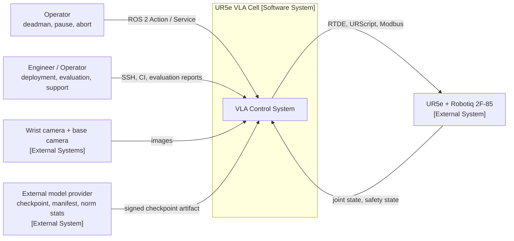
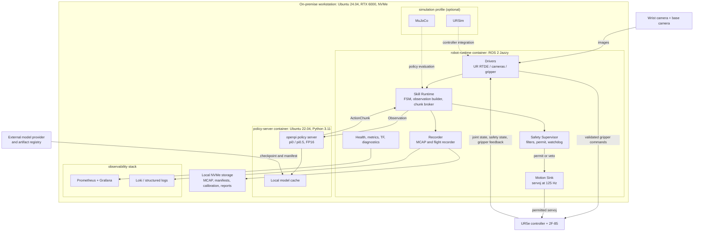
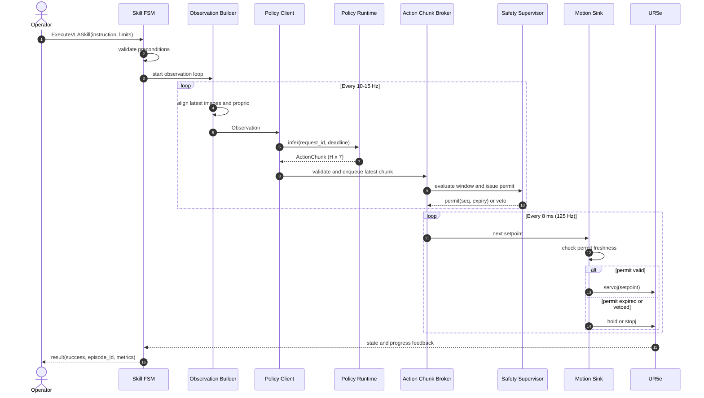
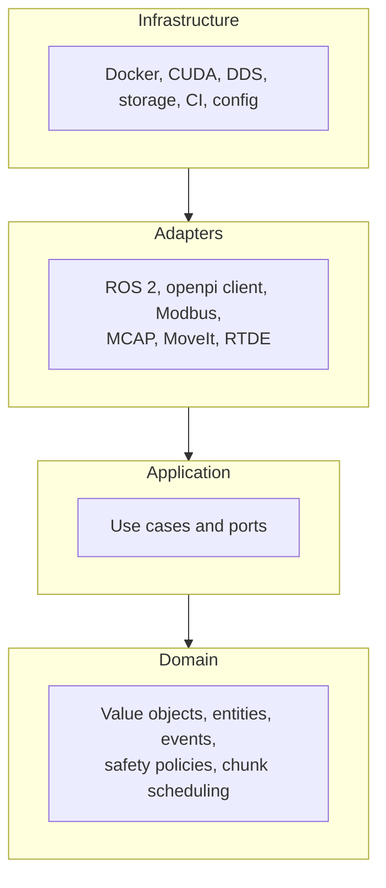
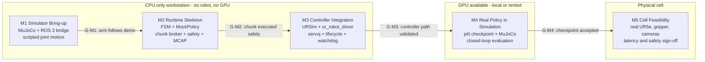
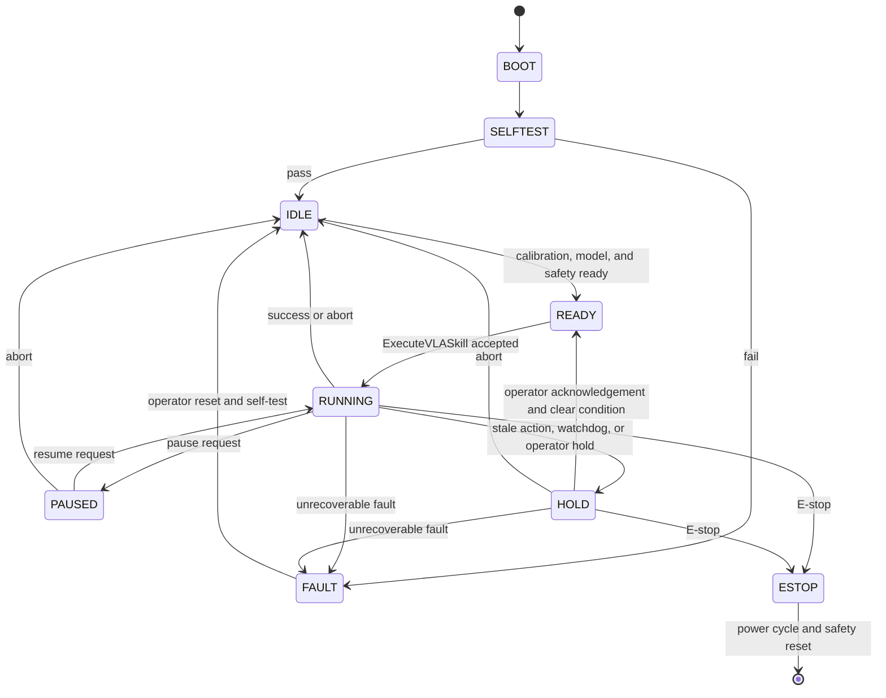
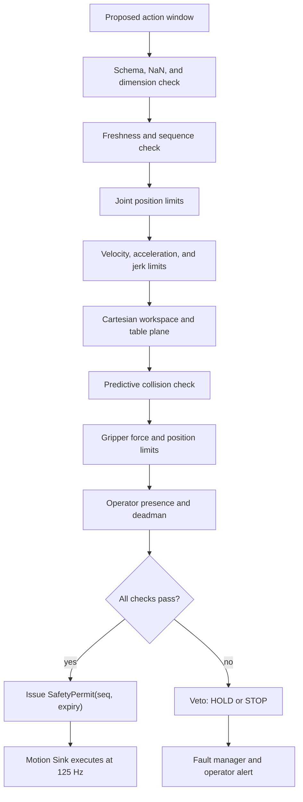
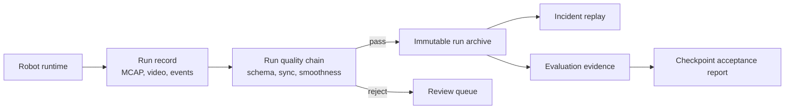
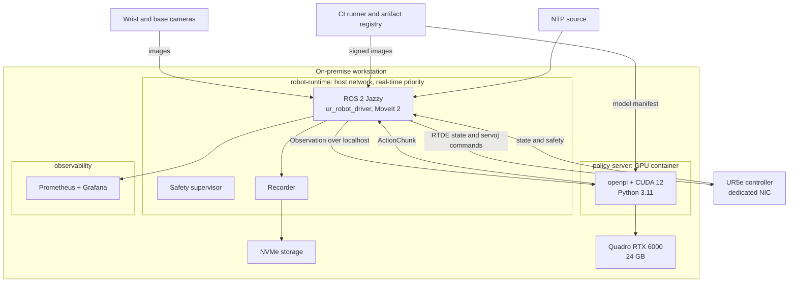

# Architecture Overview

> **Status:** Design baseline v0.1. No application code exists yet.  
> **Scope:** One UR5e cell with a Robotiq 2F-85 gripper, a Robotiq wrist camera, a fixed base camera, and an externally supplied π0-family vision-language-action checkpoint running on an NVIDIA Quadro RTX 6000. Model training, fine-tuning, and dataset creation are out of scope.  
> **Purpose:** Provide a precise, testable, and maintainable architecture before implementation starts. This document follows the structure of the `architecture.md` system template and is intended to evolve with the codebase.

This document is the primary reference for:

- the runtime and deployment boundaries,
- the observation/action contract between ROS 2 and the policy server,
- the safety model and failure behaviour,
- the checkpoint intake, validation, and evaluation pipeline,
- the test strategy and test matrix,
- the architectural decisions that must remain stable while the implementation evolves.

---

## 1. Project Structure

The repository currently contains this document, `AGENTS.md`, `README.md`, `.gitignore`, and the development container (`.devcontainer/`). No application code exists yet. The tree below is the target layout; it is created incrementally as requirements arrive. Spike code is allowed but must stay within this structure.

```text
ur5e_vla_ros2/
├── .devcontainer/                 # Development container: OpenCode on ROS 2 Jazzy
├── docs/
│   ├── adr/                       # Architecture Decision Records
│   ├── architecture/              # C4 views, contracts, safety case
│   ├── plans/                     # Milestone plans (M1 and later)
│   └── runbooks/                  # Start-up, recovery, rollback procedures
├── src/
│   ├── vla_domain/                # Pure domain: value objects, events, policies
│   ├── vla_application/           # Use cases and ports
│   ├── vla_adapters/              # ROS 2, openpi, Modbus, MCAP
│   ├── vla_safety/                # Safety filters, supervisor, permit logic
│   ├── vla_msgs/                  # ROS 2 interfaces
│   ├── vla_sim/                   # M1 MuJoCo model, simulator node, motion demo
│   ├── vla_bringup/               # Launch files and lifecycle orchestration
│   ├── vla_recorder/              # Episode recording and flight recorder
│   └── vla_eval/                  # Scenario runner and checkpoint evaluation
├── services/
│   └── policy_server/             # Python 3.11 openpi inference service
│       ├── src/
│       ├── tests/
│       ├── pyproject.toml
│       └── Dockerfile
├── sim/
│   ├── mujoco/                    # Physics simulation and policy evaluation
│   └── ursim/                     # UR controller emulation
├── config/
│   ├── robots/                    # UR5e, gripper, camera calibration
│   ├── cells/                     # Workspace, safety zones, task definitions
│   └── models/                    # Model manifests and runtime profiles
├── tests/
│   ├── unit/                      # L1 tests
│   ├── contract/                  # L2 port and adapter tests
│   ├── integration/               # L3 ROS 2 and URSim tests
│   ├── system/                    # L4 simulation scenarios
│   ├── safety/                    # L8 fault injection and E-stop tests
│   └── performance/               # L7 latency, jitter, soak tests
├── docker/                        # Dockerfiles and Compose profiles
├── scripts/                       # Developer and CI automation
├── .github/workflows/             # CI/CD pipelines
├── README.md                      # Project overview and quick start
└── ARCHITECTURE.md                # This document
```

### 1.1 Package Boundaries

| Package | May depend on | Must not depend on |
|---|---|---|
| `vla_domain` | Python standard library, pure math | ROS 2, torch, JAX, openpi, filesystem, network |
| `vla_application` | `vla_domain` | ROS 2, torch, concrete adapters |
| `vla_safety` | `vla_domain` | ROS 2, openpi, network |
| `vla_adapters` | `vla_application`, `vla_domain` | `vla_bringup` |
| `vla_msgs` | ROS 2 interface packages | application, adapters, simulators |
| `vla_sim` | `vla_msgs`, ROS 2, MuJoCo | `vla_application`, `vla_safety`, `vla_bringup` |
| `vla_recorder` | `vla_msgs`, ROS 2, MCAP | `vla_application`, `vla_bringup` |
| `vla_eval` | `vla_msgs`, ROS 2, MuJoCo, `vla_sim` | `vla_bringup` |
| `vla_bringup` | all `src` packages | `tests` |
| `services/policy_server` | openpi, PyTorch/JAX | ROS 2 |

The dependency rule is enforced in CI with `import-linter` for Python and package-level dependency checks for C++. The domain is the only place where safety and chunking semantics live; adapters only translate.

---

## 2. High-Level System Diagram

### 2.1 System Context (C4 Level 1)



The system is a single-cell, on-premise installation. It has no runtime dependency on a cloud service. The operator interacts through a guarded panel and ROS 2 actions; the engineer deploys checkpoints and configuration, runs evaluations, and inspects reports. The model is trained outside this system: the runtime consumes a versioned, signed checkpoint and manifest.

### 2.2 Container View (C4 Level 2)



**Boundary rules:**

1. The policy runtime never publishes to actuators and never imports ROS 2.
2. The robot runtime owns all motion, safety, and recording.
3. Model training is outside the system; the runtime only consumes signed checkpoints and manifests.
4. The observability plane is read-only with respect to robot control.
5. The simulation profile uses the same application and adapter contracts as the real cell.

### 2.3 Runtime Interaction



The observation loop is intentionally slower than the servo loop. The policy produces a temporally extended action chunk; the runtime interpolates and enforces limits at 125 Hz. This is the core temporal hierarchy of the system.

### 2.4 Architectural Style and Dependency Rule



The arrows show source-code dependencies, not runtime call direction. All dependencies point inward:

- **Domain** contains pure policy and safety logic. It has no framework, no I/O, and no model runtime.
- **Application** contains use cases and port interfaces. It orchestrates the domain.
- **Adapters** translate ROS 2 messages, tensors, Modbus registers, and files into domain types.
- **Infrastructure** provides process, GPU, network, storage, and configuration concerns.

The style is a **modular monolith** for the robot runtime plus one **separate policy service**. Microservices, a message broker, and Kubernetes are deliberately excluded: they add operational cost without solving a problem at single-cell scale.

### 2.5 Architectural Patterns

The following principles are mandatory design constraints, not stylistic preferences.

| Principle | Application |
|---|---|
| **Hexagonal architecture / Ports and Adapters** | Every hardware device, model server, and storage mechanism is behind a port. The domain never imports a driver. |
| **Clean Architecture / Dependency Rule** | Dependencies point inward: infrastructure → adapters → application → domain. Enforced in CI. |
| **Domain-Driven Design (lite)** | Bounded contexts, value objects, domain events, and a ubiquitous language for observations, actions, skills, and faults. |
| **Modular monolith** | One deployable robot runtime with explicit module boundaries; one separate GPU policy service. |
| **Event-driven architecture** | Domain events and telemetry are published as events; ROS 2 topics are an adapter-level transport, not the domain bus. |
| **CQRS-lite** | Commands (`StartSkill`, `Abort`, `RecordEpisode`) are separated from queries (`GetState`, `GetEpisode`). No event sourcing. |
| **Functional core, imperative shell** | Safety filters, frame math, normalization, and chunk scheduling are pure functions; I/O lives in adapters. |
| **Design by Contract** | Preconditions, postconditions, invariants, and schema validation at every boundary. |
| **Fail-fast and fail-safe** | Invalid configuration fails at start-up; invalid motion fails into HOLD or STOP. |
| **Defense in depth** | Hardware E-stop, UR safety configuration, independent supervisor, policy guard, and operational controls. |
| **Dependency injection** | Constructor injection and a composition root in `vla_bringup`; no global singletons or hidden service locators. |
| **Immutability** | Observations, action chunks, episodes, and model manifests are immutable value objects. |
| **Idempotency** | Skill requests carry a `request_id`; duplicate goals are rejected or return the original result. |
| **Make illegal states unrepresentable** | Enumerations and validated value objects replace boolean flags and stringly typed states. |
| **Parse, do not validate** | Boundary data is parsed into domain types once; downstream code never re-checks raw dictionaries. |
| **Observability by design** | Correlation identifiers, metrics, traces, and a flight recorder are part of the runtime contract. |
| **Temporal hierarchy** | Slow policy, medium-rate action chunks, fast servo loop, independent safety loop. |
| **Policy proposes, supervisor disposes** | The VLA model is never a safety function. |

| Pattern | Location | Purpose |
|---|---|---|
| **Strategy** | `PolicyBackend`, `ChunkScheduler`, `SafetyFilter`, `Transport`, `SuccessDetector` | Swap pi0 variants, scheduling policies, transports, and evaluation oracles. |
| **Abstract Factory / Factory** | `PolicyRuntimeFactory`, `ScenarioFactory` | Build a runtime or evaluation scenario from validated configuration. |
| **Builder** | `ObservationBuilder`, `EpisodeBuilder` | Assemble complex objects with validation and defaults. |
| **Adapter** | Cameras, RTDE, Modbus, openpi, MCAP | Translate external representations into domain types. |
| **Facade** | `RobotFacade`, `VLASkillFacade` | Provide a narrow API for use cases and operators. |
| **Proxy** | `RemotePolicyProxy`, `CachedPolicyProxy` | Hide network transport and provide test doubles. |
| **Decorator** | Metrics, timeout, circuit breaker, logging | Add cross-cutting behaviour without polluting core logic. |
| **Chain of Responsibility** | `SafetyChain`, `RunQualityChain` | Each filter may allow, clamp, hold, or reject. |
| **Template Method** | Recording and evaluation pipelines | Preserve step order while allowing specialization. |
| **Observer** | Health monitor, event bus, dashboards | React to heartbeats and domain events. |
| **State** | `SkillFSM`, `MotionState` | Explicit transitions instead of boolean flags. |
| **Command** | `StartSkill`, `Abort`, `RecordEpisode` | Queue, audit, and make requests idempotent. |
| **Memento** | Runtime snapshot on fault | Preserve state, last observation, last chunk, and config hashes for post-mortem replay. |
| **Null Object** | `NullPolicy`, `NullCamera`, `NullGripper` | Support degraded mode and deterministic tests. |
| **Registry / Plugin** | Model registry, task registry, backend registry | Enable checkpoint selection and controlled extension. |
| **Blackboard** | `WorldState` | Provide a read-only snapshot of robot, safety, and model health. |
| **Bulkhead** | Control, inference, recording, and UI threads/processes | A slow disk or model cannot block the servo loop. |
| **Circuit Breaker** | Policy client | Stop calling a failing model server and enter HOLD. |
| **Watchdog** | Motion sink and skill server | Detect stale commands, missed heartbeats, and overruns. |
| **Backpressure / Load shedding** | Image and request queues | Keep only the latest observation; never execute stale actions. |
| **Saga / Process Manager** | Optional long-horizon skills | Coordinate multi-step skills with compensation such as retract or home. |
| **Object Mother / Test Data Builder** | Test suites | Build readable, valid episodes and observations. |

**Anti-patterns explicitly prohibited:**

- A policy publishing directly to `/joint_states` or to the UR controller.
- Safety logic implemented inside the model or the skill policy.
- Blocking model inference inside the 125 Hz control callback.
- Unbounded image or action queues.
- A single “manager node” that owns drivers, safety, inference, and recording.
- ROS 2 message types leaking into the domain.
- Mixed units, frames, quaternion conventions, or gripper conventions.
- Different preprocessing in the checkpoint manifest and the serving path.
- Evaluation and live inference sharing a GPU without scheduling or isolation.
- Automatic restart that resumes motion without operator acknowledgement.

### 2.6 Key Architecture Decisions

| ID | Decision | Alternatives | Rationale | Consequences |
|---|---|---|---|---|
| ADR-001 | Separate robot runtime and policy runtime | Single ROS 2 process with embedded model | Crash isolation, Python 3.11 vs 3.12 compatibility, independent GPU lifecycle | Network contract, serialization, health checks |
| ADR-002 | Modular monolith plus one policy service | Microservices, Kubernetes | Single cell, single GPU, small team | Simpler operations; requires disciplined module boundaries |
| ADR-003 | ROS 2 Jazzy on Ubuntu 24.04 | Humble, newer LTS | Mature UR and MoveIt 2 support | Fewer bleeding-edge features; stable baseline |
| ADR-004 | Model actions are six joint deltas plus absolute gripper; the server returns absolute joint targets | End-effector delta, absolute joint targets from the model | Matches openpi `examples/ur5`; avoids IK and singularities in the control loop | Less cross-embodiment generalization than Cartesian actions; the `AbsoluteActions` transform is part of the contract |
| ADR-005 | 125 Hz servo, 10-15 Hz actions, 1-2 s replanning | Model inside the 125 Hz loop | Policy latency is too high for direct servo control | Chunk scheduling, staleness handling, underrun policy |
| ADR-006 | `servoj` behind `MotionPort`; joint trajectory as fallback | MoveIt Servo as the main path | Low latency and natural fit for joint targets | No collision checking at 125 Hz; requires predictive guard |
| ADR-007 | Lifecycle nodes, explicit FSM, independent supervisor | One manager node with implicit state | Predictability, testability, safety | More boilerplate; strict lifecycle ordering |
| ADR-008 | Hexagonal architecture with an anti-corruption layer | ROS 2 types throughout the codebase | Testability and hardware/model replaceability | More adapters and DTOs |
| ADR-009 | MCAP as the immutable run record | Only rosbag2, no recording | Audit, replay, and evaluation evidence | Storage retention and redaction policy |
| ADR-010 | Externally supplied checkpoints; no training in this repository | Local fine-tuning, LoRA | Project scope is the runtime and inference service; training needs data and GPUs outside the cell | Checkpoint compatibility and license become hard prerequisites |
| ADR-011 | MuJoCo plus URSim for testing | Only Gazebo or Isaac Sim | Cheap policy evaluation plus realistic controller emulation | Two simulation environments to maintain |
| ADR-012 | Shadow → assisted → autonomous rollout | Immediate autonomous operation | Safety and failure-data collection | Longer deployment schedule |
| ADR-013 | Wrist camera plus fixed base camera | Wrist-only | VLA policies need global scene context | Extra camera and calibration |
| ADR-014 | English canonical prompts for the pilot | Polish from day one | π0 checkpoints are trained predominantly on English | Localization phase requires additional data |
| ADR-015 | Safety permit (capability token) for every motion window | Trust the skill server to apply limits | Prevents a buggy or compromised skill server from bypassing safety | Permit lifecycle and expiry must be tested |
| ADR-016 | Direct MuJoCo bridge for M1; defer `ros2_control` to M2/M3 | `ros2_control` from the first commit | Smallest useful simulator milestone; no controller-manager or hardware-interface plumbing before it is needed | M1 does not validate `ros2_control`; the bridge is replaced or wrapped in M3 |
| ADR-017 | A checkpoint manifest is validated before load | Trust the checkpoint directory | Prevents incompatible or unlicensed artifacts from reaching motion | A missing or invalid manifest is a deployment blocker |

### 2.7 Requirements and Quality Attributes

**Functional requirements**

| ID | Requirement |
|---|---|
| FR-01 | Operator control, episode recording, and replay with two cameras, 125 Hz state, 10-15 Hz actions, gripper feedback, and events. |
| FR-02 | Checkpoint intake and validation: manifest, SHA-256, license, normalization statistics, and compatibility with the observation/action contract. |
| FR-03 | Evaluation of externally supplied π0-family checkpoints offline, in simulation, and on the real robot; deployment candidate selection. |
| FR-04 | Execute a skill from a natural-language instruction through a ROS 2 action; support pause, resume, and abort. |
| FR-05 | Camera, TCP, and gripper calibration with versioned hashes. |
| FR-06 | Episode and incident replay with model manifest and configuration version identification. |
| FR-07 | Model hot-swap with a manifest, health check, and rollback. |
| FR-08 | Health monitoring, diagnostics, metrics, and alerts. |
| FR-09 | Shadow, assisted, and autonomous modes with a deadman control. |
| FR-10 | Fault recovery through HOLD, retract, and explicit operator acknowledgement. |

**Non-functional requirements**

| ID | Requirement | Target |
|---|---|---|
| NFR-01 | Safety | Zero uncontrolled motions; watchdog reaction under 150 ms; hardware E-stop |
| NFR-02 | Latency | Inference p95 under 1.5 s; action age under 300 ms; 125 Hz control with p99 jitter under 5 ms |
| NFR-03 | Reproducibility | Configuration, code, container, and model hashes recorded for every run |
| NFR-04 | Observability | Metrics, structured logs, traces, and a flight recorder for every skill run |
| NFR-05 | Testability | At least 90% branch coverage in the domain; contract tests for every port |
| NFR-06 | Security | Air-gapped runtime, signed images, least privilege, and audit logs |
| NFR-07 | Maintainability | No ROS 2 or torch imports in the domain; ADRs for every significant decision |
| NFR-08 | Portability | The same application code runs against simulation and real adapters |
| NFR-09 | Resource use | Inference below 20 GB VRAM; no memory leaks during an 8-hour soak |
| NFR-10 | Licensing | openpi Apache-2.0 plus applicable Gemma and checkpoint terms reviewed before deployment |

### 2.8 Bounded Contexts

| Context | Responsibility | Key Concepts | Integration |
|---|---|---|---|
| Run Recording | Episode recording, replay, audit | Episode, RunRecord, Artifact | Publishes immutable run records |
| Checkpoint Evaluation | Checkpoint intake, offline and simulation evaluation, acceptance | Checkpoint, ModelManifest, EvaluationReport | Consumes external checkpoints; publishes acceptance reports |
| Skill Execution | Observation, inference, chunking, motion | SkillRun, Observation, ActionChunk, Setpoint | Calls safety; consumes model manifests |
| Safety and Supervision | Permits, filters, watchdog, faults | SafetyPermit, Verdict, Fault | Vetoes motion; publishes safety state |
| Operations | Health, metrics, config, rollback | Health, Metric, ConfigVersion | Read-only over runtime; controls deployment |

Contexts exchange immutable contracts and events. They do not share mutable domain entities. For example, the `Episode` aggregate in run recording is not the same object as the runtime recording descriptor.

### 2.9 Assumptions, Constraints, and Out of Scope

| Area | Assumption or Constraint | Architectural Consequence |
|---|---|---|
| Robot | UR5e, six degrees of freedom, collaborative arm | Native UR drivers and `servoj` are viable; a risk assessment is still mandatory |
| Gripper | Robotiq 2F-85, Modbus RTU, position and force feedback | Gripper is a controlled tool, not a safety device |
| Cameras | Robotiq wrist camera plus fixed base camera | Camera access is abstracted; a ROS 2-native fallback is planned |
| Development start | Hardware-free bootstrap is supported | Mock or replay policy, MuJoCo, and URSim; the RTX 6000 and real robot are validation dependencies, not M1 or M2 prerequisites |
| Compute | One Quadro RTX 6000, 24 GB, Turing | Inference and evaluation only; model training is out of scope |
| Model supply | Checkpoint, manifest, normalization statistics, and license are provided by an external team | The runtime validates compatibility; an incompatible checkpoint is a blocker, not a local fix |
| Policy | Externally supplied π0-family checkpoint through openpi | Model-specific code stays behind `PolicyPort` and the policy server; no local training |
| Runtime | Single robot, single cell | Modular monolith; no distributed orchestration |
| Network | Air-gapped runtime, no internet | All artifacts are cached and verified before operation |
| Safety | Application-level risk assessment required | Independent supervisor, E-stop, and UR safety configuration |
| Language | English canonical prompts for the pilot | Localization is a later, data-driven phase |

**Out of scope for v0.1:**

- model training, fine-tuning, LoRA, and dataset creation or curation,
- demonstration collection for training,
- mobile manipulation or a moving base,
- multi-robot coordination,
- force-controlled assembly,
- reinforcement learning in the runtime,
- cloud inference as a production runtime dependency (development-time cloud GPU inference is allowed),
- safety certification itself (the design supports, but does not replace, certification).

### 2.10 Simulation-First Bootstrap

The architecture assumes that development starts **without the physical robot and without the RTX 6000 workstation**. This is a deliberate design property, not an afterthought: from M2 onward, every hardware and GPU dependency sits behind a port, so the same application code, safety chain, and skill FSM can run against simulation adapters on a CPU-only machine. M1 deliberately precedes those abstractions and validates only the simulator and its ROS 2 bridge.

The bootstrap is a ladder of five milestones. Each milestone introduces one new class of risk, so a failure can be attributed to the layer that was just added. M1 is deliberately the smallest useful form: a simulator, a ROS 2 bridge, and scripted joint motion. It contains no VLA, no learned policy, and no safety supervisor.

| Milestone | Hardware Required | New Capability | What Moves | Exit Gate |
|---|---|---|---|---|
| **M1 Simulator Bring-up** | CPU-only workstation (8 cores, 16 GB RAM) | MuJoCo UR5e model, ROS 2 bridge, scripted trajectory | UR5e arm in MuJoCo | **G-M1:** one launch moves home → A → B → home; final joint error ≤ 0.05 rad; `/joint_states` at least 100 Hz; reset and headless mode work |
| **M2 Runtime Skeleton** | CPU-only workstation | Skill FSM, observation builder, `MockPolicy`, chunk broker, safety chain, MCAP recorder | UR5e arm in MuJoCo | **G-M2:** a deterministic chunk is executed through the safety chain at 125 Hz; MCAP replay reproduces the run; injected faults end in HOLD |
| **M3 Controller Integration** | CPU-only workstation | `ur_robot_driver`, `servoj` adapter, lifecycle, QoS, watchdog | UR5e in URSim | **G-M3:** 125 Hz setpoint stream with no missed cycle; lifecycle, QoS, and watchdog tests pass |
| **M4 Real Policy in Simulation** | GPU: local RTX 6000 or rented A100/H100/L40S | Externally supplied π0-family checkpoint, preprocessing parity, latency budget | UR5e in MuJoCo | **G-M4:** checkpoint accepted; p95 inference within budget; deterministic output; closed-loop smoke without safety violations |
| **M5 Cell Feasibility** | UR5e, Robotiq 2F-85, cameras, RTX 6000 | Real camera, gripper, and servo timing | Real UR5e | **G-M5:** camera rate, gripper response, `servoj` jitter, and inference latency measured; safety review signed off |



**M1 scope.** M1 proves that the robot model, the physics step, the joint-space interface, and the ROS 2 process boundary work before any runtime complexity is added.

- `vla_sim` package with a `mujoco_sim` node and a `trajectory_demo` node.
- MJCF model of the UR5e arm on a fixed base; no gripper and no cameras.
- Physics at 500 Hz with joint PD control plus gravity compensation from `qfrc_bias`.
- Minimum-jerk trajectory from home to A to B and back to home, sampled at 50 Hz.
- `sensor_msgs/JointState` on `/joint_states` at 125 Hz.
- `trajectory_msgs/JointTrajectory` on `/joint_trajectory`.
- `std_srvs/Trigger` on `/sim/reset`; it returns the arm to home and clears the active trajectory.
- One launch file, a headless mode, and pytest tests for the model, controller, and ROS 2 integration.
- Internal split: **M1a** is a standalone MuJoCo motion script; **M1b** adds the ROS 2 bridge, demo node, launch file, and tests.

**M1 non-goals.** No VLA model or π0 checkpoint, no GPU, no cameras, no gripper, no `ros2_control`, no MoveIt, no skill FSM, no chunk broker, no safety supervisor, no MCAP, no URSim, and no learned policy. These belong to later milestones and must not leak into M1. M1 also has no real-robot adapter, so none of its simplifications can reach hardware.

**Why M1 is meaningful.** It validates the parts that every later milestone depends on: joint order and sign, radians and units, simulation timestep, controller stability, message rates and timestamps, deterministic reset, and headless reproducibility. It also establishes the joint-state and joint-target interface that M2 reuses and M3 maps onto `servoj`. If the arm cannot follow a known trajectory in simulation, no policy result above it is trustworthy.

**Why not `ros2_control` in M1.** A direct MuJoCo bridge is a few hundred lines and has no controller-manager, hardware-interface, or `ros2_control` lifecycle to configure. M1 needs to prove physics and transport, not controller plumbing. `ros2_control` is reconsidered in M2/M3, when the URSim path and the production controller interface make it worthwhile (ADR-016).

**What M2 adds.** M2 keeps the M1 simulator as its plant and adds the runtime skeleton around it: the skill FSM, observation builder, `MockPolicy`, chunk broker, safety chain, and MCAP recorder. It is the first milestone that exercises the production observation/action contract, staleness handling, permit expiry, and failure behaviour. `MockPolicy` is a legitimate test double, not a throwaway: it implements the same `PolicyPort` boundary that the real policy server uses later.

**M3 and M4.** M3 replaces the direct bridge with the real controller path in URSim, including `ur_robot_driver`, `servoj` streaming, lifecycle, QoS, and watchdogs. M4 loads an externally supplied π0-family checkpoint and evaluates closed-loop behaviour in MuJoCo. It does not train or fine-tune the model. Task success rate, language following, and checkpoint quality cannot be evaluated before M4.

**GPU substitution.** M4 accepts any CUDA GPU with enough memory for inference (more than 8 GB per the openpi estimate). The local RTX 6000 is an optimization for latency validation and offline evaluation, not a prerequisite for starting work. Development-time cloud inference is allowed; production runtime inference remains on-premise.

**Hardware-free definition of done.** A change is considered integrated when it passes L1-L4 tests in MuJoCo and URSim. The physical cell is required only for L5-L6 and the M5 measurements.

---

## 3. Core Components

The system has no browser frontend. Operator interaction is provided through ROS 2 actions and services, a guarded physical panel, and read-only dashboards.

### 3.1 Robot Runtime (ROS 2)

**Name:** Robot Runtime

**Description:** Owns all hardware access, the 125 Hz servo loop, skill orchestration, safety enforcement, and episode recording. It is the only component allowed to command the robot or gripper.

**Technologies:** ROS 2 Jazzy, C++17 and Python 3.12, `ur_robot_driver`, `ros2_control`, MoveIt 2, `image_transport`, `rosbag2` with MCAP, CycloneDDS, Modbus RTU, `realtime_tools`.

**Deployment:** `robot-runtime` container with host networking, access to `/dev`, real-time scheduling for the control thread, and no internet access.

#### 3.1.1 Nodes

| Node | Language | Responsibility |
|---|---|---|
| `ur_bringup` | Launch / C++ | Starts `ur_robot_driver`, `controller_manager`, `robot_state_publisher`, and TF. |
| `camera_wrist` | C++ or Python | Adapts the Robotiq HTTP snapshot or a ROS 2-native wrist camera to `sensor_msgs/Image` and `CameraInfo`. |
| `camera_base` | C++ | Publishes the fixed external camera view used as global scene context. |
| `robot_state_bridge` | C++ | Converts RTDE or `ros2_control` state into the domain `RobotState`. |
| `vla_skill_server` | Python | Hosts the `ExecuteVLASkill` action, the skill FSM, observation builder, policy client, and chunk broker. |
| `safety_supervisor` | C++ | Runs the safety chain, issues permits, monitors watchdogs, and manages faults. |
| `motion_sink` | C++ | Executes permitted setpoints through `servoj` or a joint trajectory controller; implements HOLD and STOP. |
| `gripper_driver` | C++ | Controls the 2F-85 over Modbus RTU; exposes position, force, and object-detection feedback. |
| `episode_recorder` | C++ | Records MCAP, video, events, and a bounded flight recorder. |
| `teleop` | Python | Maps a SpaceMouse, VR controller, or pendant to joint targets for operator control, assisted mode, and recovery. |
| `health_monitor` | Python | Aggregates heartbeats, exposes diagnostics, and raises alerts. |
| `calibration_manager` | Python | Performs hand-eye and intrinsic calibration; publishes versioned transforms. |
| `eval_harness` | Python | Runs scripted scenarios and produces metrics and artifacts. |

#### 3.1.2 Topics and QoS

| Topic | Type | Reliability | Durability | History | Depth | Notes |
|---|---|---|---|---|---|---|
| `/camera/*/image_raw` | `sensor_msgs/Image` | BEST_EFFORT | VOLATILE | KEEP_LAST | 1 | Stale frames are discarded. |
| `/camera/*/camera_info` | `sensor_msgs/CameraInfo` | RELIABLE | TRANSIENT_LOCAL | KEEP_LAST | 1 | Latched calibration. |
| `/joint_states` | `sensor_msgs/JointState` | RELIABLE | VOLATILE | KEEP_LAST | 1 | 125-500 Hz. |
| `/gripper/state` | Custom | RELIABLE | VOLATILE | KEEP_LAST | 1 | 20-50 Hz. |
| `/vla/action_chunk` | Custom | RELIABLE | VOLATILE | KEEP_LAST | 1 | Chunk rate, deadline and lifespan set. |
| `/vla/setpoint` | Custom | RELIABLE | VOLATILE | KEEP_LAST | 1 | 125 Hz, deadline 20 ms. |
| `/safety/state` | Custom | RELIABLE | TRANSIENT_LOCAL | KEEP_LAST | 1 | Latched safety state. |
| `/safety/permit` | Custom | RELIABLE | VOLATILE | KEEP_LAST | 1 | Sequence number and expiry. |
| `/episode/events` | Custom | RELIABLE | VOLATILE | KEEP_LAST | 100 | Audit and replay. |
| `/tf`, `/tf_static` | TF messages | Default | VOLATILE / TRANSIENT_LOCAL | KEEP_LAST | 100 | Standard ROS 2 conventions. |

#### 3.1.3 Executors, Lifecycle, and Timing

- Every long-running node is a `LifecycleNode` with `configure`, `activate`, `deactivate`, `cleanup`, and `shutdown` transitions.
- A lifecycle manager starts drivers first, then perception, then the policy client, then the skill server. Shutdown runs in reverse order. The safety supervisor is active before any motion sink.
- The control path uses a single-threaded, mutually exclusive executor at 125 Hz. It performs no allocation, logging, file I/O, or blocking service calls.
- Image handling, model requests, and recording run on separate reentrant executors. A slow consumer cannot block the servo loop.
- The latest valid setpoint and safety state are exchanged through `realtime_tools::RealtimeBuffer`.
- The runtime is soft real-time. Hard safety functions remain in the UR controller and the physical E-stop circuit.
- Optional host tuning includes `PREEMPT_RT`, CPU isolation, `SCHED_FIFO`, `mlockall`, disabled power saving, and locked GPU clocks. Jitter is measured, not assumed.

#### 3.1.4 Motion Control

- The primary path is `servoj` at 125 Hz with a short lookahead window. Joint targets are interpolated from the action chunk and clipped by the safety chain.
- A joint trajectory controller is the fallback for slower, planned motions and for controller bring-up.
- MoveIt Servo is used for operator teleoperation and assisted mode, not as the main VLA path.
- A predictive collision guard evaluates the next action window at 10-15 Hz using the MoveIt planning scene and FCL. Only validated windows reach the 125 Hz loop.
- A stale setpoint triggers `stopj` and HOLD. A stale model heartbeat triggers HOLD. Recovery always requires operator acknowledgement.
- Gripper commands are rate-limited, idempotent, and force-capped. The gripper is never treated as a safety device.

#### 3.1.5 Camera Integration Risk

The Robotiq Wrist Camera does not expose an image stream through RTDE. The supported access paths are an HTTP snapshot endpoint (`http://<robot_ip>:4242/current.jpg?type=color`) and file access over SSH. This has three consequences:

1. Frame rate, latency, timestamp quality, and resolution must be measured in M5 (P2).
2. The snapshot has no hardware timestamp or `CameraInfo`; calibration and synchronization must be added explicitly.
3. If the measured rate is below 10-15 Hz, a ROS 2-native wrist camera and a fixed base camera are required for the VLA path.

A wrist-only view is also a policy limitation: the model needs global scene context. The reference openpi UR5 configuration uses a base image plus a wrist image, with the unused right-wrist slot masked. The architecture therefore treats the base camera as a first-class input, not an optional debug aid.

#### 3.1.6 Skill State Machine



The FSM is orthogonal to the safety state. A skill can be `RUNNING` while safety is `DEGRADED`; in that case motion is held, but the skill is not silently marked successful.

### 3.2 Policy Runtime (GPU)

**Name:** Policy Runtime

**Description:** Runs an externally supplied π0-family checkpoint as a stateless inference service. It receives an observation, returns an action chunk, and has no actuator access. It does not train, fine-tune, or modify model weights.

**Technologies:** Ubuntu 22.04, Python 3.11, openpi, JAX and PyTorch, CUDA 12, FP16/BF16, WebSocket or gRPC, Docker, NVIDIA Container Toolkit.

**Deployment:** `policy-server` container on the RTX 6000 workstation, reachable only over localhost or a dedicated internal socket. Model artifacts are loaded from a local cache.

#### 3.2.1 Model Variants

| Variant | Strengths | Limitations | Intended Role |
|---|---|---|---|
| **π0 base + UR5e assets** | Matches openpi `examples/ur5`; UR5e normalization assets; flow matching | Requires an externally trained UR5e checkpoint; 3B parameters | Default starting point when a compatible checkpoint is supplied |
| **π0.5 base** | Better open-world generalization; knowledge insulation | Heavier; more data-sensitive; flow head only in openpi | Challenger when a compatible checkpoint is supplied |
| **π0-FAST base** | Autoregressive; strong language following | Slower inference; different tokenizer; JAX-only in openpi | Option when language following is critical |
| **π0-DROID / π0.5-DROID** | Strong generalist; trained with a 2F-85 and Cartesian end-effector actions | Different action space and camera rig; Franka embodiment | Reference baseline, not the default |
| **π0-FAST-DROID** | Strong zero-shot language following | Inference-oriented; Cartesian actions | Fast external baseline |

Checkpoint selection compares the first three variants on the same simulation scenarios and hardware. DROID checkpoints are used as references and as a source of transferable knowledge, not as the production action-space definition. No variant is trained locally; an incompatible checkpoint is rejected or returned to the provider.

#### 3.2.2 Hardware Constraints

| Constraint | Consequence |
|---|---|
| Quadro RTX 6000, Turing, 24 GB | Inference fits comfortably; training is out of scope |
| No native BF16 | openpi defaults to BF16; FP16 or emulation must be measured for inference correctness, latency, and stability |
| openpi official estimates | Inference needs more than 8 GB; training estimates are not applicable because training is out of scope |
| PyTorch inference path | π0-FAST is available in JAX only; mixed precision, FSDP, LoRA, and EMA are training features and are not required |
| No MIG partitioning | Evaluation and live inference must be scheduled; only one heavy workload at a time |
| Reported 0.5-1 s per chunk on an RTX 4090 | Turing is expected to be slower; the runtime budget is 0.5-1.5 s |
| openpi tested on Ubuntu 22.04 | The policy container is pinned to 22.04/Python 3.11, independent of the ROS 2 host |

**Checkpoint sourcing:** the project does not train models. The checkpoint must be trained for the UR5e embodiment and supplied with a manifest, normalization statistics, preprocessing description, and license. The RTX 6000 is sized for inference and evaluation, not for training. If the supplied checkpoint is incompatible, the runtime rejects it and the provider must deliver a corrected artifact.

#### 3.2.3 Latency Budget

| Stage | Budget |
|---|---|
| Camera capture and timestamp | 33-66 ms |
| Resize and uint8 conversion on the client | 5-10 ms |
| Local transport | 2-5 ms |
| Server preprocessing | 5-10 ms |
| π0 forward pass, 10 flow steps | 400-900 ms, to be measured |
| Postprocessing and return transport | 5-10 ms |
| **Total** | **0.5-1.0 s** |
| Safety and servo step at 125 Hz | 8 ms per cycle |

With an action horizon of 50 steps at 15 Hz, one chunk covers 3.3 s. Executing 15-25 steps before replanning gives a 1-1.7 s execution window, which accommodates a 1 s inference. If inference exceeds 1.5 s, the runtime must increase the execution horizon or reduce the action rate; reactivity is traded explicitly, not accidentally.

#### 3.2.4 Server Behaviour

- One model per process, resident in GPU memory, warmed up for 10-20 iterations before readiness.
- The server only loads a checkpoint with a valid manifest and never trains or mutates weights.
- Single-flight execution with a queue depth of one. New observations replace queued observations; stale requests are dropped.
- Every request carries `request_id`, `deadline`, schema version, and model version. Responses with an expired request are ignored.
- `/healthz`, `/version`, and `/metrics` endpoints expose readiness, model manifest, and latency.
- A deterministic mode uses a fixed flow-matching seed for regression tests.
- Optimizations are introduced only after measurement: FP16, `torch.compile`, CUDA graphs, fewer denoising steps, and eventually TensorRT.
- The server never loads a model per request and never performs blocking filesystem I/O on the inference path.

**Policy-free operation.** The `PolicyPort` has two CPU-only implementations used from M2 onward: `MockPolicy`, which emits a deterministic, configurable action chunk, and `ReplayPolicy`, which replays a recorded action chunk from an MCAP run record. Both implement the same request/response contract, deadlines, and error codes as the real remote client, so the runtime, safety chain, and tests do not need to change when a checkpoint is connected. This is what allows M2 and M3 to run on a CPU-only workstation without any GPU.

A third implementation, `NullPolicy`, rejects every request and is used to test the fail-safe path when no model is available. The composition root selects the implementation from validated configuration; no code path branches on `if model_available` at runtime.

#### 3.2.5 Reference Implementation Notes

The openpi UR5 example provides a concrete baseline:

- base checkpoint: `pi0_base`,
- normalization assets: `asset_id="ur5e"`,
- state: six joint positions plus gripper,
- images: base RGB plus left-wrist RGB; the right-wrist slot is zeroed and masked,
- action: seven dimensions (six joint deltas plus absolute gripper),
- output transform: `AbsoluteActions` converts the model output back to absolute joint targets,
- prompt source: the instruction supplied in the observation; the manifest documents any task-field convention.

These details must be verified against the actual joint order, units, gripper convention, and camera calibration. If the supplied UR5e normalization assets are missing or incompatible, the checkpoint is rejected. The project does not compute training statistics; the manifest must include the `norm_stats` hash.

### 3.3 Safety and Supervision

**Name:** Safety Supervisor

**Description:** An independent, deterministic component that evaluates every proposed motion window, issues time-limited permits, monitors watchdogs, and drives the system into HOLD or STOP. It does not depend on the model or on the skill server for correctness.

**Technologies:** C++ preferred, ROS 2, UR safety configuration, hardware E-stop, MoveIt/FCL for predictive collision checks, standard safety relays and monitoring.

**Deployment:** `robot-runtime` container, separate node and process priority, active before any motion sink. For higher assurance, the supervisor can run as a separate systemd unit or container with its own watchdog; the E-stop and UR safety functions never depend on it.

#### 3.3.1 Safety Layers

| Layer | Mechanism |
|---|---|
| L0 Hardware | E-stop, safety-rated UR configuration, joint and TCP limits, force and speed limits, fencing or safety scanner |
| L1 UR controller | Protective stop, reduced mode, speed slider, tool and payload limits |
| L2 Supervisor | Workspace box, joint/velocity/acceleration/jerk limits, command watchdog, model health, permit expiry |
| L3 Policy guard | Action clipping, jerk limiting, gripper force cap, allowed envelope |
| L4 Operations | Deadman, operator presence, procedures, operator training, restricted speed during pilot |

#### 3.3.2 Safety Chain



Every filter is a pure function of the proposed window, the current world state, and configuration. Filters return `ALLOW`, `CLAMP`, `HOLD`, or `STOP` with a machine-readable reason. The chain is ordered from cheapest to most expensive; the collision check runs at the action rate, not at 125 Hz.

#### 3.3.3 Safety Permit

The supervisor issues a `SafetyPermit` containing:

- a monotonically increasing sequence number,
- the hash of the validated window,
- an expiry timestamp,
- the maximum permitted joint delta,
- the safety configuration version.

The motion sink accepts a setpoint only if the permit is valid, unexpired, and matches the current sequence. This capability-token design prevents a buggy skill server or a stale action chunk from bypassing the supervisor.

#### 3.3.4 Fault Taxonomy

| Fault | Detection | Reaction | Recovery |
|---|---|---|---|
| `E_STOP` | Hardware circuit | Immediate stop | Power cycle and safety reset |
| `PROTECTIVE_STOP` | UR controller | Stop and report | Operator acknowledgement |
| `WATCHDOG` | Missing setpoint or heartbeat | `stopj`, HOLD | Operator acknowledgement |
| `SAFETY_VETO` | Safety filter | HOLD or STOP | Clear condition and acknowledgement |
| `MODEL_TIMEOUT` | Deadline exceeded | HOLD | Model health check and acknowledgement |
| `MODEL_CRASH` | Process or health endpoint | HOLD, restart policy | Restart, warm-up, acknowledgement |
| `CAMERA_LOSS` | Frame age or stream error | HOLD | Restore stream, recalibrate if needed |
| `GRIPPER_FAULT` | Modbus error, stall, force limit | Stop gripper, HOLD | Inspect object and gripper |
| `IK_FAIL` | Solver failure | HOLD | Replan or operator intervention |
| `SINGULARITY` | Jacobian condition or workspace guard | HOLD | Move away from singularity |
| `COMM_LOSS` | DDS liveliness or RTDE disconnect | HOLD or STOP | Restore network, acknowledge |
| `GPU_OOM` | CUDA error or health probe | HOLD, degrade | Restart policy server |
| `CONFIG_INVALID` | Start-up validation | Fail fast, refuse activation | Fix configuration |
| `CALIBRATION_INVALID` | Hash or reprojection check | Refuse motion | Recalibrate |

No fault automatically resumes motion. Transient sensor recovery may clear a warning, but returning to `READY` always requires an operator acknowledgement.

#### 3.3.5 Failure Mode and Effects Analysis

| Failure mode | Detection | Local effect | System reaction | Test |
|---|---|---|---|---|
| Stale action chunk | Timestamp and age | Old target | HOLD before execution | U-03, F-02 |
| Corrupted action | Schema and NaN check | Invalid setpoint | Reject window | U-01, C-02 |
| Workspace violation | Cartesian guard | Unsafe target | CLAMP or HOLD | U-01, F-07 |
| Collision prediction | FCL check | Unsafe window | HOLD | S-02, F-07 |
| Model server death | Health probe | No new chunk | HOLD, restart | F-02 |
| Camera freeze | Frame age | Stale observation | HOLD | F-01 |
| Gripper stall | Position/force feedback | Object not grasped | Stop gripper, report | F-06 |
| DDS partition | Liveliness | Missing state | HOLD or STOP | F-03 |
| Clock jump | Monotonic clock check | Bad timestamps | Reject setpoints | F-04 |
| E-stop | Hardware circuit | Power removed | Immediate stop | F-08, H-02 |

#### 3.3.6 Safety Case

- Risk assessment follows ISO 12100, ISO 10218-1/-2, and ISO/TS 15066 as applicable.
- The VLA policy is treated as a non-safety-rated component of a powered machine.
- The E-stop, UR safety configuration, and protective stop are independent of ROS 2, the network, and the model.
- Validation includes fault injection, stop-time measurement, force and speed verification, and an external safety review.
- The project does not claim certification. It is designed so that a certification process can be performed on the final cell.

### 3.4 Run Recording and Replay

**Name:** Run Recording Plane

**Description:** Captures every skill run, evaluation run, and incident as an immutable MCAP record for audit, replay, and failure analysis. It does not create model-training datasets or collect demonstrations.

**Technologies:** ROS 2, MCAP, `rosbag2`, FFmpeg/H.264, JSON Schema, content-addressed storage.

**Deployment:** The recorder runs inside the robot runtime; replay and reporting run on the workstation or in CI.

#### 3.4.1 Data Model

| Entity | Key Fields | Notes |
|---|---|---|
| `Episode` | `episode_id`, `skill_id`, `instruction`, `operator`, `robot_serial`, `cell_id`, start/end time, outcome, failure code, interventions, calibration hash, config hash, code SHA, model manifest hash | Immutable after publication |
| `RunRecord` | `run_id`, episode ID, scenario ID, seeds, environment version, metrics, artifacts | One evaluation or replay execution |
| `ModelManifest` | `model_id`, version, family, base, provider, checkpoint SHA-256, norm-stats hash, action/state spaces, image slots, horizon, control frequency, precision, evaluation results, license | Required before deployment |

The run record is the audit source of truth. It is not a training dataset.

#### 3.4.2 Recording Protocol

- Record two camera views, 125 Hz proprioception, 10-15 Hz action targets, gripper commands and feedback, and operator events.
- Use a SpaceMouse, VR controller, or pendant for operator control and recovery. Record joint targets rather than Cartesian velocities.
- Synchronize streams with ROS message timestamps and `message_filters::ApproximateTime`; mark samples with a synchronization error above 20 ms.
- Store native-resolution video and raw state. Resize and normalize only in the serving and evaluation pipelines.
- Record success, failure, interventions, and safety events explicitly.
- Apply a retention policy; incidents are kept longer than routine runs.
- Do not record secrets, credentials, or personal data.

#### 3.4.3 Quality Gates

A `RunQualityChain` evaluates each run before it enters the archive:

1. Schema and required-field validation.
2. Monotonic timestamps; no gap above 100 ms.
3. Camera-to-state synchronization error below 20 ms.
4. No NaN, infinity, or out-of-range joint values.
5. Action deltas below configured thresholds; jerk within limits.
6. Gripper events consistent with gripper state and object detection.
7. Image decodability, exposure, blur, and frame-rate checks.
8. Duration within 2-120 s; instruction non-empty; task ID valid.
9. No unlabelled collision or safety stop.

Rejected records enter a review queue with a reason code. A human decision is recorded; it is never silently overwritten.

#### 3.4.4 Recording and Replay Pipeline



### 3.5 Checkpoint Evaluation and Acceptance

**Name:** Checkpoint Evaluation Plane

**Description:** Accepts externally supplied π0-family checkpoints, validates their manifests and compatibility, evaluates them offline and in closed-loop simulation, and produces an acceptance report. It never trains or modifies weights.

**Technologies:** openpi inference, JAX and PyTorch, MuJoCo, pytest, JSON/CSV reports, optional MLflow for evaluation tracking.

**Deployment:** Workstation or CI GPU. Evaluation and live inference are scheduled, not concurrent by default.

#### 3.5.1 Checkpoint Intake

- Require a manifest with model family, base checkpoint, provider, SHA-256, license, normalization statistics, action/state spaces, image-slot mapping, action horizon, control frequency, and precision.
- Verify the checkpoint SHA-256 and the manifest hash before loading.
- Verify that the action space is six joint deltas plus absolute gripper, or a documented compatible transform.
- Verify that the state order, units, camera names, and image-slot mapping match the runtime contract.
- Reject a checkpoint with missing or incompatible `norm_stats`; the project does not compute training statistics.
- Evaluate supplied variants on the same simulation scenarios and hardware. Select by closed-loop success, latency, memory, language following, and license terms, not by offline loss alone.
- Keep preprocessing identical between the manifest and the serving path.

#### 3.5.2 Evaluation Protocol

| Level | What is measured | Scale |
|---|---|---|
| Manifest and golden checks | Schema, SHA-256, tensor shapes, deterministic output, preprocessing parity | Fixed golden observations |
| Offline | Action error against provider-supplied reference actions; distribution shift | Provider validation set |
| Simulation | Task success, time, path length, collisions, recovery | 100-500 episodes per checkpoint |
| Real assisted | Success, interventions, safety stops, time | 20-50 episodes per checkpoint |
| Real autonomous | Success with confidence interval, OOD performance, incidents | 50-150 episodes per condition |

Closed-loop task success is the primary acceptance metric. Every evaluation report includes the checkpoint SHA-256, manifest hash, scenario seeds, and environment version.

#### 3.5.3 Model Manifest

```yaml
model_id: ur5e-pi0-pilot
version: 0.1.0
family: pi0
base_checkpoint: pi0_base
provider: external-team
checkpoint_sha256: sha256:...
norm_stats_hash: sha256:...
action_space: joint_delta_6_plus_gripper_absolute
state_space: joint_position_6_plus_gripper
image_slots:
  base_0_rgb: external_camera
  left_wrist_0_rgb: wrist_camera
  right_wrist_0_rgb: masked
action_horizon: 50
control_frequency_hz: 15
precision: fp16
license: review_required
evaluation:
  simulation_success: 0.0
  real_success: null
manifest_sha256: sha256:...
```

The manifest is the deployment contract. A policy server refuses to load a checkpoint without a valid manifest, and the runtime records the manifest hash with every run.

### 3.6 Simulation and Test Harness

**Name:** Simulation Plane

**Description:** Provides fast, repeatable closed-loop evaluation and controller integration without the real robot.

**Technologies:** MuJoCo with a ROS 2 control bridge, URSim, optional Gazebo, pytest, custom scenario runner, fault injector.

**Deployment:** CI and workstation simulation profile. It uses the same application and adapter contracts as the real cell, with simulation adapters substituted at the composition root.

- **MuJoCo** is the primary policy-evaluation environment: UR5e, 2F-85, wrist and base cameras, randomized objects and lighting, success oracle, and parallel episodes.
- **URSim** is the primary controller-integration environment: real `ur_robot_driver`, controller switching, RTDE behaviour, and lifecycle tests.
- **Gazebo** is optional and used only when a specific sensor or ROS 2 integration cannot be covered by the other two.
- **Fault injection** covers camera freeze, model timeout, model crash, DDS partition, clock jump, GPU OOM, gripper stall, and E-stop.
- Scenario definitions are versioned YAML files with fixed seeds. Results are stored as machine-readable artifacts and linked to the model manifest.

**M1 is a special case.** M1 runs before the runtime skeleton exists: the `mujoco_sim` node and the `trajectory_demo` node communicate directly over `/joint_states` and `/joint_trajectory`. There is no `PolicyPort`, safety supervisor, or MCAP in M1. This is intentional; M1 validates the plant and the transport, not the production control path.

**M2/M3 without a GPU.** From M2 onward, the MuJoCo and URSim profiles run with `MockPolicy` or `ReplayPolicy` selected at the composition root. They exercise the real ROS 2 runtime, the real controller driver in URSim, and the real safety supervisor, and they record to MCAP. A GPU is needed only when a π0 checkpoint is loaded in M4; it is not needed to demonstrate that the robot moves in simulation.

**Adapter completeness.** The same scenario file runs against the MuJoCo adapter, the URSim adapter, and the real cell. Only the composition root and the adapter implementations differ. A scenario that passes in MuJoCo but fails in URSim points at the controller integration; a scenario that passes in URSim but fails on the cell points at hardware, calibration, or timing.

### 3.7 Observability and Operations

**Name:** Operations Plane

**Description:** Makes runtime behaviour, checkpoint quality, run recording quality, and safety events observable and auditable.

**Technologies:** Prometheus, Grafana, NVIDIA DCGM exporter, Loki or a structured file sink, OpenTelemetry, MCAP flight recorder.

**Deployment:** Local observability stack on the workstation. No telemetry leaves the cell network by default.

| Signal | Examples |
|---|---|
| Inference | `vla_inference_latency_seconds`, `vla_action_age_seconds`, `vla_chunk_underruns_total` |
| Control | `vla_control_jitter_seconds`, `vla_setpoint_rejections_total`, `vla_servo_saturation_total` |
| Safety | `vla_safety_veto_total{reason}`, `vla_safety_stop_total`, `vla_watchdog_trips_total` |
| Gripper | `vla_gripper_force_newtons`, `vla_gripper_errors_total`, `vla_grasp_success_total` |
| Model | `vla_model_reload_total`, `vla_model_health`, `vla_gpu_memory_bytes` |
| Recording | `vla_recorder_dropped_frames_total`, `vla_episode_valid_total`, `vla_sync_error_seconds` |
| DDS | `vla_dds_liveliness_lost_total`, `vla_dds_publish_latency_seconds` |

**Logging:** structured JSON with `skill_run_id`, `episode_id`, `request_id`, `model_version`, `safety_state`, and `trace_id`. High-rate control code does not log inside the 125 Hz loop.

**Tracing:** OpenTelemetry spans across observation construction, policy request, inference, chunk validation, safety evaluation, and actuation. The trace connects the ROS 2 runtime to the policy server.

**Flight recorder:** a bounded ring buffer of the last 30-60 s of state, images, actions, safety events, and model responses. On a fault it is dumped to MCAP for post-mortem replay.

**Alerts:** model server down, action age above threshold, safety veto spike, watchdog trip, GPU OOM, camera frame-rate drop, disk space below 10%, and calibration hash mismatch.

**Runbooks:** start-up, shutdown, calibration, model rollback, fault recovery, run archive backup, and incident review. A runbook step that changes motion always requires an operator confirmation.

### 3.8 Ports and Contracts

| Port | Responsibility | Invariants |
|---|---|---|
| `CameraPort` | Latest frame per view | Monotonic timestamp; non-blocking; explicit encoding and calibration hash |
| `RobotStatePort` | Joint positions, velocities, gripper, end-effector pose | Age below 20 ms; SI units; calibrated frames |
| `PolicyPort` | `infer(Observation) -> ActionChunk` | Schema valid; deadline enforced; no side effects; stale requests rejected |
| `MotionPort` | Execute setpoints, hold, stop | Limits enforced; idempotent stop; explicit unit and frame |
| `GripperPort` | Position, force, feedback | Normalized 0-1; force cap; idempotent commands |
| `RunStorePort` | Publish and read immutable run records | Immutable; content-addressed; schema-valid |
| `ModelRegistryPort` | Resolve a model manifest | SHA-256 verified; license recorded |
| `CalibrationPort` | Provide transforms and intrinsics | Versioned hash; valid time window |
| `ClockPort` | Time source | Monotonic for control; wall clock for logs |
| `EventPort` | Publish domain and telemetry events | At-most-once for telemetry; ordered per skill run |

**Observation schema, version 1**

```text
request_id: UUID
robot_id: string
timestamp_ns: int64
seq: uint64
images:
  base_0_rgb: uint8[224,224,3]
  left_wrist_0_rgb: uint8[224,224,3]
  right_wrist_0_rgb: uint8[224,224,3] or zeros
image_mask:
  base_0_rgb: bool
  left_wrist_0_rgb: bool
  right_wrist_0_rgb: bool
state: float32[7]          # six joint positions in radians plus normalized gripper
prompt: string
meta:
  calibration_hash: string
  model_version: string
  schema_version: "1"
```

**Action chunk schema, version 1**

```text
request_id: UUID
model_version: string
timestamp_ns: int64
actions: float32[50,7]     # absolute joint targets plus gripper
inference_ms: float32
server_version: string
```

**Contract rules**

- The schema has a semantic major and minor version. A major mismatch is rejected; a minor mismatch is accepted only for additive, optional fields.
- The policy server returns absolute joint targets after the `AbsoluteActions` transform. The runtime does not apply a second delta conversion.
- The gripper convention is defined once (0 = open, 1 = closed) and verified by a physical test. It is recorded in the model manifest and the run record.
- Frame conventions, units, joint ordering, and image color order are part of the contract and are covered by golden tests.
- Unknown fields are ignored only at the boundary; they never reach the domain model.

---

## 4. Data Stores

| Store | Type | Purpose | Retention | Backup |
|---|---|---|---|---|
| Run record store | MCAP, MP4, JSONL | Audit, replay, incident and evaluation evidence | Policy-defined, normally permanent | Nightly to external disk |
| Evaluation artifact store | JSON, CSV, MP4, MCAP | Acceptance reports and evidence per checkpoint | Versioned, per checkpoint | Nightly |
| Model registry | Filesystem plus manifest index | Externally supplied checkpoints, manifests, evaluation reports | All deployed versions plus last N | Nightly and off-site |
| Calibration and configuration | YAML, JSON, URDF, Xacro | Robot, camera, workspace, safety configuration | Every version | Git plus backup |
| Telemetry and logs | Prometheus TSDB, Loki, files | Operations and incident analysis | 30-90 days | Optional |
| Flight recorder and test artifacts | MCAP, videos, reports | Post-mortem and regression evidence | 90 days or per incident | Per release |

### 4.1 Run Record Store

**Name:** Run Record Store  
**Type:** MCAP plus MP4 and JSONL  
**Purpose:** Lossless capture of every skill, evaluation, and replay run. It is the source of truth for audit, incident analysis, and evaluation evidence.  
**Key schemas:** `run_metadata`, `joint_states`, `action_targets`, `gripper_state`, `camera_frames`, `safety_events`, `operator_events`.

### 4.2 Evaluation Artifact Store

**Name:** Evaluation Artifact Store  
**Type:** JSON, CSV, MP4, and MCAP  
**Purpose:** Store acceptance reports, scenario results, metrics, and videos linked to a checkpoint manifest.  
**Key records:** `evaluation_report`, `scenario_result`, `metric_series`, `evaluation_video`.

### 4.3 Model Registry

**Name:** Model Registry  
**Type:** Content-addressed filesystem with a manifest index  
**Purpose:** Resolve an externally supplied model version to a checkpoint, normalization statistics, configuration, and evaluation evidence.  
**Key records:** `model_manifest`, `checkpoint`, `evaluation_report`, `license_review`.

### 4.4 Calibration and Configuration Store

**Name:** Configuration and Calibration Store  
**Type:** Git-tracked YAML, JSON, URDF, Xacro, and calibration artifacts  
**Purpose:** Reproducible robot, camera, workspace, and safety configuration.  
**Key artifacts:** `ur5e.urdf.xacro`, `robotiq_2f_85.xacro`, `camera_intrinsics.yaml`, `hand_eye.yaml`, `workspace.yaml`, `safety_limits.yaml`, `task_registry.yaml`.

### 4.5 Telemetry and Log Store

**Name:** Telemetry and Log Store  
**Type:** Prometheus TSDB, Loki, structured JSON files  
**Purpose:** Runtime monitoring, alerting, and incident reconstruction.  
**Key streams:** inference latency, action age, safety vetoes, control jitter, GPU usage, camera frame rate.

### 4.6 Flight Recorder and Test Artifacts

**Name:** Flight Recorder and Test Artifacts  
**Type:** Bounded in-memory ring buffer, dumped to MCAP; test reports and videos  
**Purpose:** Preserve the last window before a fault and provide evidence for test gates.  
**Key artifacts:** `incident.mcap`, `scenario_report.json`, `evaluation_video.mp4`, `pytest_report.xml`.

---

## 5. External Integrations / APIs

| External System | Purpose | Integration Method | Notes |
|---|---|---|---|
| Universal Robots controller | Robot state, motion, tool communication | RTDE, URScript, Dashboard server, `ur_robot_driver` | Dedicated NIC; no internet |
| Robotiq Wrist Camera | Wrist-view images | HTTP snapshot and SSH file access | No RTDE image stream; measure FPS and latency |
| Robotiq 2F-85 | Gripper position, force, object detection | Modbus RTU over UR tool communication or USB-RS485 | Force cap and stall detection required |
| External checkpoint provider | Checkpoint, manifest, normalization statistics, license | Offline transfer or allow-listed registry | SHA-256 and license verified before load |
| URSim | Controller emulation | Docker or VM; `ur_robot_driver` connection | Used in integration tests |
| MuJoCo | Physics simulation | Python API and ROS 2 control bridge | Used for policy evaluation |
| Evaluation reporting | Acceptance reports and metrics | File-based JSON/CSV, optional MLflow | Reports linked to the checkpoint manifest |
| NVIDIA DCGM | GPU metrics | Prometheus exporter | Local only |
| Container registry | Signed runtime images | OCI registry | Pinned digests |
| GitHub Actions | CI/CD | Git push and pull requests | Self-hosted GPU runner for performance tests |
| NTP source | Time synchronization | NTP | Host and controller offsets are logged |

**Runtime dependency policy:** the live cell must continue to operate if the internet and the artifact registry are unavailable. All model artifacts, images, and configuration are cached locally before a run.

---

## 6. Deployment & Infrastructure

**Cloud Provider:** None. The system is deployed on-premise, and the runtime cell is isolated from the internet.

**Key Services Used:**

- One Ubuntu 24.04 workstation with an NVIDIA Quadro RTX 6000, 24 GB.
- One UR5e controller on a dedicated network interface.
- Two cameras: Robotiq wrist camera and a fixed base camera.
- One Robotiq 2F-85 gripper on the UR tool flange.
- Local NVMe storage for run records, evaluation reports, models, and logs.
- Uninterruptible power supply for the workstation and the robot controller.
- Optional external backup disk.

### 6.1 Deployment Diagram



### 6.2 Containers

| Container | Base Image | Responsibilities | Privileges |
|---|---|---|---|
| `robot-runtime` | Ubuntu 24.04 + ROS 2 Jazzy | Drivers, safety, skill runtime, motion, recording | Host network, `/dev`, real-time scheduling, no internet |
| `policy-server` | Ubuntu 22.04 + Python 3.11 + CUDA 12 | Model loading and inference | GPU, localhost port, no ROS, no actuator access |
| `observability` | Prometheus, Grafana, Loki, DCGM exporter | Metrics, logs, dashboards | Read-only scrapes |
| `sim-mujoco` | Ubuntu 24.04 + MuJoCo | Policy evaluation | No real hardware |
| `sim-ursim` | URSim image | Controller emulation | Isolated network |

Docker Compose is sufficient. Kubernetes is not used. Systemd starts Compose at boot and stops it cleanly; the robot runtime does not auto-resume motion after a fault.

### 6.3 Network

| Segment | Purpose | Controls |
|---|---|---|
| Cell LAN | Workstation, UR controller, cameras | Static addresses, dedicated NIC, firewall, no internet |
| DDS | ROS 2 discovery and topics | Localhost or cell LAN only; unicast; CycloneDDS profile |
| Policy channel | Observation and action chunks | Localhost WebSocket or Unix socket; schema validation |
| Management | SSH and CI | Key-based authentication, restricted source addresses |
| Artifact transfer | Model and image delivery | Offline import or allow-listed registry mirror |

The UR controller is never exposed to the corporate network. The camera HTTP endpoint is treated as an unauthenticated internal service and is reachable only from the workstation.

### 6.4 Real-Time and Performance Configuration

- Optional `PREEMPT_RT` kernel; measured before being claimed.
- `isolcpus` for the control core; `SCHED_FIFO` for the control thread.
- `mlockall` for the control process.
- Disabled CPU frequency scaling and deep C-states during operation.
- GPU clocks locked with `nvidia-smi -lgc` for repeatable latency.
- No evaluation, indexing, or backup jobs during a live skill.
- `cyclictest` and runtime jitter metrics recorded during acceptance.
- Network jitter measured between the workstation and the UR controller.

### 6.5 Start-Up and Shutdown

**Start-up order:**

1. Host, network, NTP, and storage checks.
2. UR controller and safety configuration verification.
3. Camera and gripper drivers.
4. Robot state and TF.
5. Safety supervisor and watchdog.
6. Policy server warm-up and manifest verification.
7. Skill server activation.
8. Operator acknowledgement and READY state.

**Shutdown order:** stop skill, hold motion, deactivate skill server, stop policy server, deactivate drivers, flush recorder, stop observability.

A failed step prevents activation. It does not fall through to a degraded motion mode.

### 6.6 GPU Scheduling

The RTX 6000 is dedicated to inference and occasional evaluation. The supported modes are:

- **Production:** the policy server owns the GPU; no evaluation.
- **Maintenance:** the robot is in HOLD and an operator has confirmed; evaluation may run.
- **Experiment:** evaluation with strict priority, only after latency validation.

There is no MIG partitioning on this GPU. Concurrent evaluation and live inference is not a supported production configuration. Model training is out of scope and never runs on this GPU.

### 6.7 Configuration and Secrets

- Configuration is versioned in Git and validated by JSON Schema at start-up.
- Calibration artifacts are content-addressed and referenced by hash.
- Secrets are provided through Docker secrets or systemd credentials; they are never committed.
- Model manifests include the checkpoint, norm-stats, code, and container hashes.
- Safety parameters cannot be changed at runtime without a lifecycle transition and an audit event.

### 6.8 CI/CD Pipeline

| Stage | Checks | Artifact |
|---|---|---|
| Pull request | Lint, unit, contract, build, schema validation, docs | Test report |
| Nightly | Simulation smoke, fault injection, latency, recovery | Scenario report, MCAP |
| Weekly | Full simulation suite, soak, OOD, checkpoint evaluation | Evaluation report |
| Release candidate | HIL, acceptance, safety review, rollback drill | Signed images, model manifest |
| Deployment | Image digest and model manifest verification | Deployment record |

### 6.9 Environments

| Environment | Purpose | Hardware | Data |
|---|---|---|---|
| Development | Unit and contract tests | Laptop or workstation | Fakes and recorded fixtures |
| CI | Build, unit, contract, simulation smoke | CPU and GPU runner | Fixed seeds and fixtures |
| Simulation | Policy and system evaluation | Workstation or CI GPU | MuJoCo and URSim |
| Cell | HIL and real-robot validation | UR5e cell | Real episodes, guarded |
| Production | Pilot operation | UR5e cell | Real episodes, monitored |

### 6.10 Rollback

- Model rollback restarts only the policy server with a previous manifest; the robot runtime remains running.
- Runtime rollback deploys a previous signed image digest.
- Configuration rollback restores a previous Git commit and calibration hash.
- A rollback never bypasses safety checks and never resumes motion without operator acknowledgement.

### 6.11 Monitoring and Logging

- Prometheus scrapes runtime, policy server, GPU, and recorder metrics.
- Grafana provides separate dashboards for runtime health, safety, checkpoint quality, and run recording.
- Loki or a structured JSON sink stores logs with correlation identifiers.
- OpenTelemetry traces connect ROS 2 callbacks, policy requests, and safety decisions.
- The flight recorder captures the last 30-60 s of high-rate data for incident replay.
- Alerts are routed to the operator panel and the on-call engineer; safety alerts are never suppressed by model-quality alerts.

---

## 7. Security Considerations

### 7.1 Authentication

- SSH access uses per-engineer keys; password login is disabled.
- UR controller accounts use unique credentials and the vendor-recommended privilege model.
- Operator identification uses a badge, PIN, or named session, depending on the cell policy.
- Service-to-service access uses local sockets or mutually authenticated channels where supported.
- The Robotiq camera HTTP endpoint has no application authentication; it is protected by network isolation only.

### 7.2 Authorization

| Role | Permissions |
|---|---|
| Observer | Read dashboards and episode metadata |
| Operator | Start, pause, abort, acknowledge faults, enable deadman |
| Engineer | Calibrate, change configuration, deploy models, run evaluations |
| Administrator | Host, network, accounts, and container lifecycle |

Authorization is enforced at the ROS 2 action/service boundary and at the deployment layer. The policy runtime has no motion authority.

### 7.3 Data Encryption and Integrity

- TLS 1.3 for any artifact transfer that crosses the cell boundary.
- Full-disk encryption (LUKS) for the workstation and backup disks where required.
- SHA-256 verification of model checkpoints and container images.
- Signed container images and an SBOM for every release.
- No secrets in source control, logs, MCAP, or model manifests.

### 7.4 Network Security

- Air-gapped runtime network; no inbound internet.
- Dedicated NIC for the UR controller.
- DDS restricted to localhost or the cell LAN; multicast discovery disabled where possible.
- Firewall rules allow only required ports and sources.
- No remote desktop or debug service exposed to the corporate network.
- USB media is scanned and controlled.

### 7.5 Supply Chain

- Base images pinned by digest.
- Python dependencies locked with `uv` or an equivalent lockfile.
- ROS 2 packages pinned by distribution and version.
- Model artifacts accompanied by a manifest, license record, and checksum.
- openpi code is Apache-2.0; Gemma and checkpoint terms require legal review before commercial deployment.
- SBOM and vulnerability scan required for release.

### 7.6 Audit and Monitoring

- Every skill request, model version, safety event, configuration change, and operator acknowledgement is logged.
- Logs are append-only or shipped to a protected store.
- Incident review uses the flight recorder and the model manifest.
- Access to logs and recordings is role-controlled.

### 7.7 Threat Model Summary

| Threat | Impact | Control |
|---|---|---|
| Unauthorized motion command | Injury or damage | ROS 2 authorization, safety permit, deadman, network isolation |
| Stale or replayed action chunk | Uncontrolled motion | Request IDs, sequence numbers, expiry, watchdog |
| Model artifact tampering | Unsafe policy | SHA-256, signed manifests, offline registry |
| Camera stream spoofing | Wrong observation | Network isolation, frame-age checks, calibration hash |
| DDS eavesdropping or injection | Data leak or command injection | Localhost/segment isolation, DDS security where available |
| SSH compromise | Full workstation control | Key-only auth, least privilege, audit, no internet |
| Malicious dependency | Code execution | Lockfiles, SBOM, scanning, pinned digests |
| Physical access | Safety bypass | Locked cabinet, E-stop, cell guarding, procedures |

**Safety is not security.** The safety case assumes the software may be faulty or compromised; the E-stop and UR safety functions remain independent.

### 7.8 Key Security Tools and Practices

| Tool / Practice | Purpose |
|---|---|
| SSH key management and hardware-backed keys | Protect privileged access |
| Host firewall and network segmentation | Limit reachable services |
| Container image signing and digest pinning | Prevent unauthorized runtime changes |
| SBOM and dependency scanning | Detect vulnerable or unexpected components |
| Secrets management | Keep credentials out of images and Git |
| Audit logging | Trace commands, model versions, and configuration changes |
| Backup encryption and restore drills | Protect data and verify recoverability |
| Periodic access review | Remove stale accounts and permissions |
| Incident response runbook | Provide a defined response to security events |

---

## 8. Development & Testing Environment

### 8.1 Local Setup

The repository currently has no runnable application code. The target development environment is:

- Ubuntu 24.04 host with ROS 2 Jazzy.
- Docker Engine and NVIDIA Container Toolkit.
- `colcon`, `rosdep`, and `vcstool` for ROS 2 packages.
- `uv` and Python 3.11 inside the policy container.
- `pytest`, `launch_testing`, and `colcon test`.
- A GPU-enabled runner for inference and performance tests.

The `.devcontainer` is the OpenCode agent environment on the `ros:jazzy-ros-base` image; it provides ROS 2 Jazzy and `colcon` for local builds and tests. It is a development container, not the deployment artifact. The runtime image will live under `docker/`.

**Hardware-free bootstrap.** A CPU-only Ubuntu 24.04 workstation with Docker is sufficient for P0a1-P0a3 (M1-M3). M1 needs only Python, MuJoCo, and ROS 2 Jazzy. M2 adds the runtime skeleton, safety supervisor, and `MockPolicy` or `ReplayPolicy`. M3 adds URSim. No NVIDIA GPU, UR controller, camera, or gripper is required for any of these. The GPU is introduced in M4 (P0b) and the physical cell in M5 (P2).

**Repository conventions:**

- Trunk-based development with short-lived branches and pull requests.
- Conventional Commits and semantic versioning for artifacts.
- One ADR per significant architectural decision.
- No generated run archives, model weights, or secrets in Git.
- Code owners for `vla_safety`, `vla_domain`, and `policy_server`.
- Pre-commit hooks are mandatory and identical in local and CI environments.

### 8.2 Testing Strategy

#### 8.2.1 Test Levels

| Level | Scope | Environment | Tooling | Frequency | Gate |
|---|---|---|---|---|---|
| **L1 Unit** | Domain, math, safety filters, FSM | Host, no ROS | `pytest`, Hypothesis, GoogleTest | Every PR | 100% pass; domain branch coverage at least 90% |
| **L2 Contract** | Ports and adapters | Host with fakes | `pytest`, reusable contract suites | Every PR | Every port contract passes |
| **L3 Component** | ROS 2 nodes, lifecycle, QoS, TF | URSim or MuJoCo | `launch_testing`, `colcon test` | Nightly | No failures |
| **L4 System** | Full stack in closed loop | MuJoCo or URSim | Scenario runner, pytest | Nightly | Success thresholds met |
| **L5 HIL** | Real controller and low-speed robot | Cell | Checklist and scripts | Release | Zero unsafe events |
| **L6 Acceptance** | Real tasks with operator | Cell | Pre-registered protocol | Release | Success confidence interval met |
| **L7 Non-functional** | Latency, jitter, soak, chaos | Simulation and cell | Custom harness, `tc`, `stress-ng` | Nightly/weekly | Budgets met |
| **L8 Safety** | Fault injection and E-stop | Simulation and cell | Fault injector, safety checklist | Release | Safety sign-off |

#### 8.2.2 Test Doubles

| Double | Replaces | Behaviour |
|---|---|---|
| `FakeCamera` | Real camera | Recorded frames, configurable delay, drop, freeze, and corruption |
| `FakeRobot` | UR5e | Kinematic or MuJoCo-backed state and motion |
| `FakePolicy` | openpi server | Replay, canned, noisy, or adversarial chunks |
| `FakeGripper` | 2F-85 | Position/force state machine, stall and object detection |
| `FakeClock` | Wall and monotonic clock | Deterministic time, jumps, and expiry tests |
| `ObjectMother` | Domain factories | Valid episodes, observations, and manifests for tests |
| `ContractSuite` | Adapter-specific tests | Reusable assertions applied to every implementation |

#### 8.2.3 Test Oracles

| Oracle | Use |
|---|---|
| **Invariants / properties** | Safety filters, interpolation, frame math, chunk scheduling |
| **Golden values** | Preprocessing, normalization, quaternion and frame conversions |
| **Contract assertions** | Schema, timing, error codes, idempotency |
| **Statistical thresholds** | Closed-loop success rate with confidence intervals |
| **Metamorphic relations** | Instruction paraphrase, small image perturbation, action scaling |
| **Differential comparison** | New model or runtime versus a frozen baseline |
| **Human checklist** | Acceptance, safety review, cell readiness |

#### 8.2.4 Test Environments

| Environment | Purpose | Real hardware | Determinism |
|---|---|---|---|
| Host | Unit and contract | No | High |
| CI | Build and smoke | No | High |
| MuJoCo | Policy and system evaluation | No | Seeded |
| URSim | Controller and ROS 2 integration | Emulated controller | Seeded |
| Cell | HIL and acceptance | Yes | Limited, guarded |
| Production | Pilot and monitoring | Yes | Limited, guarded |

#### 8.2.5 Testing Frameworks

| Framework | Use |
|---|---|
| `pytest` | Python unit, contract, integration, and system tests |
| `Hypothesis` | Property-based tests for safety filters, frames, and chunking |
| `launch_testing` | ROS 2 node lifecycle, topic, and action integration |
| GoogleTest | C++ unit and component tests |
| `colcon test` | ROS 2 package test orchestration |
| MuJoCo | Closed-loop policy and system evaluation |
| URSim | Controller and driver integration |
| `tc`, `stress-ng`, custom fault injector | Network, resource, and fault-injection tests |
| `mutmut` or `Mull` | Mutation testing of critical logic |
| `cyclictest`, DCGM, Prometheus | Latency, jitter, and GPU monitoring |

### 8.3 Code Quality and Standards

| Area | Standard |
|---|---|
| Python formatting and linting | `ruff format`, `ruff check` |
| Python typing | `mypy` or `pyright` in strict mode for domain and application |
| Python architecture | `import-linter` enforcing dependency direction |
| C++ formatting | `clang-format` with a repository `.clang-format` |
| C++ static analysis | `clang-tidy`, compiler warnings as errors |
| C++ runtime checks | AddressSanitizer, UndefinedBehaviorSanitizer, ThreadSanitizer where applicable |
| ROS 2 testing | `colcon test`, `launch_testing`, `ros2 doctor` |
| Property-based testing | Hypothesis for Python invariants |
| Mutation testing | `mutmut` or `Mull` on safety and frame-math code; target mutation score at least 80% |
| Coverage | Domain at least 90% branch; safety decision logic at 100% branch |
| Contract testing | JSON Schema or Protobuf validation at every boundary |
| Documentation | ADRs, C4 views, runbooks, and checkpoint acceptance reports |
| Dependency management | Lockfiles, pinned images, SBOM, vulnerability scan |
| Commit hygiene | Conventional Commits, focused PRs, mandatory review for safety code |

**Coverage is not a goal by itself.** A high line-coverage number with weak assertions is treated as a failing quality signal. Critical safety branches require explicit tests, mutation testing, and review.

### 8.4 Test Matrix

#### 8.4.1 Unit, Contract, and Integration Tests

| ID | Scope | Environment | Oracle / Metric | Frequency | Gate |
|---|---|---|---|---|---|
| U-01 | Safety chain: joint, velocity, acceleration, jerk limits | Host | Property: output always within limits; unsafe input rejected | Every PR | Blocking |
| U-02 | Frame and unit conversions: joint/end-effector, quaternion/rotvec | Host | Golden values and round-trip properties | Every PR | Blocking |
| U-03 | Chunk broker and setpoint interpolation | Host | Fake clock; no gaps; bounded jerk; stale chunk rejected | Every PR | Blocking |
| U-04 | Normalization and denormalization | Host | Round-trip; no NaN; q01/q99/std sanity | Every PR | Blocking |
| U-05 | Skill and safety state machines | Host | Model-based tests; illegal transitions rejected | Every PR | Blocking |
| U-06 | Configuration and episode schema validation | Host | Invalid input fails fast with a precise error | Every PR | Blocking |
| C-01 | Camera port: frame rate, timestamp, encoding, drop behaviour | Host with fixture | Contract suite plus measured latency | Every PR | Blocking |
| C-02 | Policy port: schema, deadline, stale request, error codes | Host with fake server | Contract suite and fault injection | Every PR | Blocking |
| C-03 | Gripper port: idempotency, 0/1 convention, force cap | Host with Modbus simulator | Contract suite and physical convention test | Every PR | Blocking |
| C-04 | Motion port: limits, hold, stop, units, frames | URSim | Contract suite | Every PR | Blocking |
| C-05 | Run store port: round-trip, immutability, content hash | Host | Contract suite and property tests | Every PR | Blocking |
| I-01 | Lifecycle bring-up and teardown | URSim | Order enforced; no motion during configure | Nightly | Blocking |
| I-02 | QoS and DDS behaviour | URSim | Latency, drops, liveliness, discovery | Nightly | Blocking |
| I-03 | TF and calibration chain | URSim | TF age, reprojection error, hash consistency | Nightly | Blocking |
| I-04 | Recorder: MCAP run record and replay | Simulation | Schema valid; synchronization error below 20 ms; replay matches the recorded run | Nightly | Blocking |
| I-05 | URSim `servoj` streaming with `MockPolicy` (M3) | URSim | 125 Hz setpoint stream; no missing cycle; watchdog and lifecycle behaviour correct | Nightly | Blocking |

#### 8.4.2 System, Safety, Performance, Acceptance, Recording, and Checkpoint Tests

| ID | Scope | Environment | Oracle / Metric | Frequency | Gate |
|---|---|---|---|---|---|
| S-00 | M1 simulator bring-up | MuJoCo | One launch moves home → A → B → home; final joint error ≤ 0.05 rad; `/joint_states` at least 100 Hz; reset and headless mode work; CPU only | Every PR | Blocking |
| S-00b | M2 runtime smoke with `MockPolicy` | MuJoCo | Deterministic chunk executed at 125 Hz through the safety chain; MCAP replay reproduces the run; injected fault ends in HOLD | Every PR | Blocking |
| S-01 | Nominal pick-and-place | MuJoCo | Success at least 90% over 100 seeded episodes | Nightly | Blocking |
| S-02 | Clutter and occlusion | MuJoCo | Success at least 70% | Nightly | Blocking |
| S-03 | Instruction paraphrase | MuJoCo | Success drop at most 10 percentage points | Weekly | Warning, then blocking |
| S-04 | Out-of-distribution object and lighting | MuJoCo | Reported success and failure taxonomy | Weekly | Informational |
| S-05 | Long-horizon and multi-object tasks | MuJoCo | Success at least target; no safety events | Weekly | Blocking |
| F-01 | Camera freeze or frame drop | Simulation | HOLD within 150 ms; no collision | Nightly | Blocking |
| F-02 | Model timeout, crash, or restart | Simulation | HOLD; no stale action executed; acknowledgement required | Nightly | Blocking |
| F-03 | DDS partition and recovery | URSim | HOLD or STOP; no runaway motion | Nightly | Blocking |
| F-04 | Clock jump and monotonicity | Simulation | Invalid setpoints rejected | Nightly | Blocking |
| F-05 | GPU out-of-memory | Real GPU | Graceful degradation and HOLD | Weekly | Blocking |
| F-06 | Gripper stall and force limit | Simulation and cell | Force cap respected; fault reported | Weekly | Blocking |
| F-07 | Singularity and collision prediction | Simulation | HOLD; no jump; no collision | Nightly | Blocking |
| F-08 | E-stop and watchdog | Cell and URSim | Stop time within specification; no residual motion | Release | Blocking |
| P-01 | Inference latency p50/p95/p99 | RTX 6000 | p95 within budget | Every PR / nightly | Blocking |
| P-02 | Control jitter at 125 Hz | Cell and URSim | p99 below 5 ms | Weekly | Blocking |
| P-03 | Eight-hour soak | Simulation and cell | No memory leak, drift, or watchdog spike | Weekly | Blocking |
| P-04 | Start-up and recovery time | Simulation | Under 30 s; operator acknowledgement enforced | Weekly | Blocking |
| H-01 | Real robot at reduced speed | Cell | Checklist pass; zero unsafe events | Release | Blocking |
| H-02 | Acceptance on three tasks | Cell | Success confidence interval meets target | Release | Blocking |
| D-01 | Run record quality chain | Offline | Invalid run records rejected with reason codes | Every PR | Blocking |
| D-02 | Checkpoint manifest validation | Host | Missing or invalid SHA-256, norm stats, action/state space, or license rejected before load | Every PR | Blocking |
| M-01 | Offline action error versus reference | GPU | Not worse than frozen baseline on the provider validation set | Every PR | Blocking |
| M-02 | Simulation closed-loop versus baseline | MuJoCo | At least 20 percentage points improvement | Release | Blocking |
| M-03 | Deterministic inference | GPU | Identical output for fixed seed and input | Every PR | Blocking |
| M-04 | Checkpoint/runtime preprocessing parity | GPU | Identical tensor hash for a golden observation | Every PR | Blocking |

### 8.5 Risk Coverage

| Risk | Tests |
|---|---|
| MuJoCo model, units, or bridge error | U-02, S-00, S-01 |
| Camera unavailable or too slow | C-01, F-01, S-01, H-01 |
| Inference latency above budget | P-01, F-02 |
| Unsafe or stale action | U-01, F-01 to F-08, H-02 |
| Simulation-to-reality gap | S-01 to S-05, H-02 |
| Incompatible or unlicensed checkpoint | D-02, M-01, M-04 |
| Provider checkpoint quality insufficient | M-01, M-02 |
| Frame, unit, or convention error | U-02, C-04, M-04 |
| Checkpoint/runtime preprocessing mismatch | U-04, M-04 |
| GPU contention or OOM | P-01, F-05 |
| DDS or QoS misconfiguration | I-02, F-03 |
| Gripper failure or wrong convention | C-03, F-06, S-01 |
| Calibration drift | I-03, D-01 |
| Checkpoint regression | M-01, M-02, M-03 |

### 8.6 Statistical Evaluation

- Report task success with a 95% Wilson confidence interval, per task and in aggregate.
- For A/B model comparisons, use paired episodes with identical initial conditions and McNemar's test.
- Use sequential testing (Bayesian beta-binomial or group sequential) to stop early without inflating false positives.
- A practical power example: distinguishing 65% from 80% success at 80% power requires roughly 150 episodes per arm.
- Simulation supports 200-500 episodes per checkpoint; real-robot evaluation uses 50-100 episodes per condition.
- Pre-register success criteria, tasks, object sets, instructions, and stopping rules before collecting evaluation data.
- Do not gate a release on a single run, a single seed, or a single task.
- Store videos, MCAP, metrics, and model manifests with every evaluation report.

### 8.7 CI Gates

| Gate | Required Checks |
|---|---|
| Pull request | Lint, type check, unit, contract, build, schema, documentation, dependency review |
| Merge to main | All PR gates plus simulation smoke and container build |
| Nightly | L3 and L4 tests, fault injection, latency, recovery |
| Weekly | Full simulation suite, soak, OOD, checkpoint evaluation |
| Release candidate | HIL, acceptance, safety review, rollback drill, SBOM, license review |
| Checkpoint acceptance | Offline checks, simulation evaluation, manifest validation, acceptance report |

Flaky tests are quarantined with an owner and a deadline. Test retries are allowed only for infrastructure failures, never for assertion failures. Every quarantine is visible in the dashboard.

### 8.8 Definition of Done

A change is done only when:

- The behavior is covered at the appropriate test level.
- Safety-relevant branches have explicit tests and mutation coverage.
- Contracts and schemas are updated and versioned.
- Observability is added for new failure modes.
- Documentation and ADRs are updated.
- The change has been exercised in simulation or URSim, unless it is domain-only.
- No new TODO is left without an owner and an issue.
- A rollback path exists for runtime, configuration, or model changes.

---

## 9. Future Considerations / Roadmap

### 9.1 Roadmap and Gates

| Phase | Duration | Deliverable | Exit Gate |
|---|---|---|---|
| **P0a1 Simulator Bring-up (M1)** | 4-5 days | `vla_sim` package, MuJoCo UR5e model, `mujoco_sim` bridge, `trajectory_demo`, launch file, tests | **G0a1:** one launch moves home → A → B → home with final error ≤ 0.05 rad; `/joint_states` at least 100 Hz; reset and headless mode work; tests pass |
| **P0a2 Runtime Skeleton (M2)** | about 1 week | Skill FSM, observation builder, `MockPolicy`/`ReplayPolicy`, chunk broker, safety chain, MCAP recorder | **G0a2:** deterministic chunk executed at 125 Hz through the safety chain; replay reproduces the run; fault injection ends in HOLD |
| **P0a3 Controller Integration (M3)** | about 1 week | URSim profile, `ur_robot_driver`, `servoj` adapter, lifecycle, QoS, watchdog | **G0a3:** 125 Hz setpoint stream without a missed cycle; lifecycle, QoS, and watchdog tests pass |
| **P0b GPU Policy Feasibility (M4)** | about 1 week, once a GPU is available | Checkpoint intake, manifest validation, policy server integration, latency and memory measurement, simulation smoke | **G0b:** supplied checkpoint loads and passes manifest checks; p95 inference below 1.5 s; deterministic output; closed-loop smoke with zero safety violations |
| **P1 Simulation Closed Loop** | 2-3 weeks | Full stack, scenario suite, fault injection, regression suite | **G1:** success target met; zero safety violations in fault injection |
| **P2 Cell Feasibility (M5)** | 1-2 weeks, once the cell is available | Camera, gripper, `servoj`, latency, and safety measurements on the real cell | **G2:** camera at least 10-15 Hz or fallback approved; jitter p99 below 5 ms; gripper response below 500 ms; safety review signed off |
| **P3 Shadow and Assisted** | 2-4 weeks | Shadow mode, assisted mode, deadman, failure data | **G3:** 50 episodes; zero uncontrolled motions; interventions below 20% |
| **P4 Autonomous Pilot** | 4-6 weeks | Guarded cell, 100+ episodes, statistical evaluation | **G4:** success target met with lower confidence bound; safety sign-off |
| **P5 Hardening** | 2 weeks | Runbooks, rollback, handover, operations readiness | **G5:** operational readiness review passed |

P0a is split into three sub-phases because each one has a different failure surface. P0a1 needs only a CPU workstation and can start immediately. P0a2 reuses the M1 simulator as its plant and adds the production runtime contracts. P0a3 adds URSim and the real controller path. P0b is the first GPU phase and evaluates an externally supplied checkpoint; it never trains or fine-tunes a model. P1 can run in simulation as soon as M3 and M4 are closed, even if the cell is not yet available. P2 needs the physical cell. No checkpoint is promoted to the cell before G0b and G1, and no autonomous motion starts before G2 and G3.

```mermaid
flowchart LR
    subgraph CPU["CPU-only - no robot, no GPU"]
        P0a1["P0a1 Simulator Bring-up (M1)<br/>MuJoCo + ROS 2 bridge<br/>scripted motion"] --> G0a1{"G0a1"}
        G0a1 -->|"pass"| P0a2["P0a2 Runtime Skeleton (M2)<br/>FSM + MockPolicy<br/>safety + MCAP"]
        P0a2 --> G0a2{"G0a2"}
        G0a2 -->|"pass"| P0a3["P0a3 Controller Integration (M3)<br/>URSim + servoj"]
        P0a3 --> G0a3{"G0a3"}
    end

    G0a1 -->|"fail"| Y["Fix model, units, or bridge"]
    G0a2 -->|"fail"| Z["Fix runtime or contracts"]
    G0a3 -->|"fail"| W["Fix controller integration"]

    subgraph GPU["GPU available - local or rented"]
        P0b["P0b GPU Policy Feasibility (M4)<br/>checkpoint intake + latency"] --> G0b{"G0b"}
    end

    G0a3 -->|"pass"| P0b
    G0b -->|"fail"| X["Reject checkpoint<br/>or fix compatibility"]
    G0a3 -->|"runtime ready"| P1["P1 Simulation Closed Loop"]
    G0b -->|"checkpoint accepted"| P1
    P1 --> G1{"G1"}
    G1 -->|"pass"| P2["P2 Cell Feasibility (M5)<br/>camera + gripper + servo"]
    G1 -->|"fail"| V["Fix policy or scenario"]
    P2 --> G2{"G2"}
    G2 --> P3["P3 Shadow and Assisted"]
    P3 --> G3{"G3"}
    G3 --> P4["P4 Autonomous Pilot"]
    P4 --> G4{"G4"}
    G4 --> P5["P5 Hardening"]
```



### 9.2 Architectural Debt and Uncertainties

| Item | Impact | Current Position | Resolution |
|---|---|---|---|
| Robotiq wrist camera frame rate and timestamp quality | High | Unmeasured | P2 (M5) measurement; fallback to ROS 2-native camera |
| BF16/FP16 behaviour on Turing | High | Unverified | P0b (M4) benchmark and numerical comparison |
| Checkpoint compatibility with the runtime contract | High | Unverified per delivery | Manifest validation and M4 acceptance; reject incompatible artifacts |
| Checkpoint supply latency | Medium | External dependency | Freeze a known-good artifact and keep a rollback version |
| openpi API and checkpoint changes | Medium | External dependency | Pin versions and wrap behind `PolicyPort` |
| UR driver and PolyScope compatibility | Medium | Version-sensitive | Pin versions and test in URSim |
| M1 direct MuJoCo bridge diverges from `ros2_control` | Medium | Accepted for M1 (ADR-016) | Re-evaluate in M2/M3; keep the `/joint_states` and joint-target contract stable |
| Simulation-to-reality gap | High | Expected | Domain randomization, shadow mode, provider-led fine-tuning |
| Safety certification | High | Not started | Risk assessment and external review in P2/P3 |
| Model licensing | Medium | Under review | Legal review before commercial deployment |
| Calibration drift | Medium | Unknown | Hash, periodic verification, rigid mounts |

### 9.3 Planned Evolutions

- TensorRT or a compiled inference path for lower latency, after numerical validation.
- Additional camera views and multi-view fusion if the base-plus-wrist setup is insufficient.
- Multi-robot deployment behind the same contracts, with per-robot policy sessions.
- Additional checkpoint variants from the provider behind the same `PolicyPort` contract.
- An optional feedback export of recorded failure cases to the external model provider.
- ROS 2 LTS upgrade after UR and MoveIt 2 support is verified.
- Formal safety certification and a validated safety case.

### 9.4 Open Decisions

Decisions 1, 5, and 11 concern the GPU and the external checkpoint and must be confirmed before P0b. Decisions 3, 7, 8, and 10 can follow before the cell phase. Decisions 2, 4, 6, and 9 are resolved by ADR-003, ADR-004, ADR-011, and ADR-014; decision 12 is resolved for M1 by ADR-016. Resolved decisions stay recorded because they are revisited at a later milestone.

1. Exact GPU model: Quadro RTX 6000 Turing 24 GB or RTX 6000 Ada 48 GB.
2. ROS 2 distribution: Jazzy on Ubuntu 24.04 (resolved, ADR-003). A newer LTS is revisited only after driver verification.
3. Camera strategy: accept the Robotiq snapshot rate, or add a higher-rate ROS 2-native wrist camera. The two-camera layout itself is resolved (ADR-013).
4. Action space: six joint deltas plus absolute gripper, with the `AbsoluteActions` transform (resolved, ADR-004). End-effector deltas are not part of the contract.
5. Checkpoint variants to evaluate: pi0 base, pi0.5 base, and optionally pi0-FAST.
6. Simulation scope: MuJoCo plus URSim (resolved, ADR-011). Another simulator is added only on a concrete requirement.
7. Pilot tasks: three concrete tasks, object sets, success criteria, and sample size.
8. Safety ownership: risk assessment, cell guarding, and external review responsibility.
9. Language policy: English canonical prompts for the pilot, with later localization (resolved, ADR-014).
10. Network policy: air-gap, dedicated NIC, and remote support constraints.
11. Checkpoint sourcing: provider, delivery format, manifest completeness, license, and update cadence.
12. `ros2_control` adoption: direct MuJoCo bridge for M1 (chosen, ADR-016), then re-evaluate in M2/M3 or introduce it from the start.

### 9.5 Key Risks

| Risk | Likelihood | Impact | Mitigation |
|---|---|---|---|
| Wrist camera cannot provide a usable stream | High | Critical | P2 measurement; fallback camera; base camera |
| Checkpoint incompatible with the runtime contract | High | High | Manifest validation, golden checks, M4 acceptance, reject and request a corrected artifact |
| Inference exceeds the latency budget | Medium | High | Chunking, execution horizon, FP16, compilation, smaller variant |
| Provider checkpoint quality insufficient | High | High | Offline and simulation acceptance gates; request a new checkpoint; do not promote |
| Simulation-to-reality gap | High | High | Domain randomization, shadow mode, provider-led fine-tuning |
| Unsafe action reaches the robot | Medium | Critical | Independent supervisor, permits, E-stop, fault injection |
| Frame or unit convention error | Medium | High | Contract tests, golden values, visualization |
| Gripper latency or feedback error | Medium | Medium | Modbus adapter, force cap, contract tests |
| DDS or QoS misconfiguration | Medium | Medium | QoS matrix, integration tests, CycloneDDS profile |
| Calibration drift | Medium | Medium | Hash, periodic verification, rigid mounting |
| Evaluation and inference contention | Medium | Medium | Maintenance windows or separate machine |
| Checkpoint supply delay | Medium | Medium | Freeze a known-good artifact and keep a rollback version |
| License restrictions | Medium | Medium | Legal review of openpi, Gemma, and checkpoint terms |

### 9.6 Immediate Next Steps

1. Confirm the open decisions in Section 9.4 that affect M2 and later; M1 has no open hardware dependency.
2. Approve ADR-016, ADR-017, and the M1 scope in Section 2.10.
3. Scaffold `vla_sim` and add the MJCF UR5e arm model with a fixed base.
4. Build M1a: a standalone MuJoCo script with 500 Hz physics, joint PD control plus gravity compensation, and a minimum-jerk home → A → B → home trajectory. Measure tracking error and stability before adding ROS 2.
5. Build M1b: the `mujoco_sim` node publishing `/joint_states` at 125 Hz, the `trajectory_demo` node publishing `/joint_trajectory`, the `/sim/reset` service, one launch file, and a headless mode.
6. Add the M1 tests (model, controller, integration) and close G0a1 before starting M2.
7. Start P0a2/M2: define the `PolicyPort` and `MotionPort` contracts, the skill FSM, the observation builder, `MockPolicy`, the chunk broker, the safety chain, and the MCAP recorder; close G0a2.
8. Add the URSim profile and close G0a3 (M3): `ur_robot_driver`, `servoj` streaming, lifecycle, QoS, and watchdog tests.
9. Before M4, agree the checkpoint intake contract with the provider: manifest fields, SHA-256, normalization statistics, preprocessing description, action/state spaces, and license.
10. When a GPU is available, run M4 with an externally supplied checkpoint in MuJoCo; measure latency, memory, determinism, and closed-loop smoke; close G0b. Do not train or fine-tune locally.
11. Run P1 Simulation Closed Loop with the full stack, scenario suite, and fault injection; close G1.
12. When the cell is available, execute P2/M5 measurements: camera rate, gripper response, `servoj` jitter, inference latency, and safety review; close G2.
13. Move to the real robot only after the safety chain, watchdog, and fault-injection tests pass, and only in shadow mode first.

---

## 10. Project Identification

| Field | Value |
|---|---|
| **Project Name** | UR5e VLA ROS 2 |
| **Repository URL** | TBD; update when the remote repository is created |
| **Primary Contact / Team** | TBD |
| **Document Owner** | Architecture Team |
| **Status** | Design baseline v0.1 |
| **Date of Last Update** | 2026-10-28 |
| **Scope** | Single UR5e cell with Robotiq 2F-85, wrist and base cameras, externally supplied π0-family checkpoint, RTX 6000 |
| **Model Supply** | External provider; training and fine-tuning are out of scope |
| **Related Documents** | ADRs (planned), test plan (planned), checkpoint acceptance contract (planned), M1 milestone plan (Section 2.10), safety case (planned), runbooks (planned) |
| **Reference Implementations** | openpi `examples/ur5`; openpi remote inference; Robotiq camera HTTP access |

**References:**

- openpi repository and model documentation: <https://github.com/Physical-Intelligence/openpi>
- openpi UR5 example: <https://github.com/Physical-Intelligence/openpi/tree/main/examples/ur5>
- openpi remote inference: <https://github.com/Physical-Intelligence/openpi/blob/main/docs/remote_inference.md>
- Robotiq Wrist Camera image access: <https://blog.robotiq.com/knowledge/retrieving-robotiq-wrist-camera-pictures-on-a-computer-5-1736280755515>

---

## 11. Glossary / Acronyms

| Term | Definition |
|---|---|
| **Action chunk** | A sequence of future actions produced by the policy in one inference call; typically 50 steps. |
| **Action horizon** | Number of future actions predicted by the model. |
| **Assisted mode** | The policy proposes motion and the operator enables it with a deadman control. |
| **Autonomous mode** | The policy executes under supervision without continuous operator input. |
| **BF16 / FP16** | 16-bit floating-point formats; BF16 has a wider exponent, FP16 has more mantissa bits. Turing lacks native BF16. |
| **Checkpoint** | The externally supplied model weights plus the manifest needed to load and validate them. |
| **Chunk broker** | Runtime component that validates, schedules, and expires action chunks. |
| **CQRS** | Command Query Responsibility Segregation; commands and queries use separate paths. |
| **DDS** | Data Distribution Service, the middleware used by ROS 2. |
| **Deadman** | A control that must be actively held for assisted motion to continue. |
| **DROID** | A large open robot manipulation dataset and platform; useful as a reference policy. |
| **End effector (EE)** | The robot tool, here the Robotiq 2F-85 gripper. |
| **Episode** | One recorded skill, evaluation, or replay run from start to finish. |
| **Flight recorder** | A bounded buffer of recent runtime data dumped on a fault for post-mortem analysis. |
| **FSM** | Finite State Machine. |
| **G0a1-G0a3 / G0b** | Phase gates for simulator bring-up, runtime skeleton, controller integration, and GPU policy feasibility. |
| **G1-G5** | Phase gates for simulation closed loop, cell feasibility, shadow/assisted, pilot, and hardening. |
| **G-M1 to G-M5** | Milestone acceptance gates. They map to the phase gates as G0a1, G0a2, G0a3, G0b, and G2 respectively. |
| **M1-M5** | Bootstrap milestones: simulator bring-up, runtime skeleton, controller integration, real policy in simulation, and cell feasibility. |
| **MockPolicy** | A CPU-only `PolicyPort` implementation that emits a deterministic action chunk for runtime and safety testing. |
| **ReplayPolicy** | A CPU-only `PolicyPort` implementation that replays a recorded action chunk from an MCAP run record. |
| **HIL** | Hardware-in-the-loop testing. |
| **HOLD** | A controlled state that stops motion and waits for an operator. |
| **Jerk** | Rate of change of acceleration; limited to avoid shock and oscillation. |
| **Lifecycle node** | A ROS 2 node with explicit configure, activate, deactivate, and cleanup transitions. |
| **MCAP** | A modular container format for recorded robotics data. |
| **MoveIt Servo** | A MoveIt 2 component for real-time Cartesian or joint teleoperation. |
| **MuJoCo** | A physics simulator used for the M1 plant, closed-loop policy evaluation, and regression tests. |
| **Model provider** | The external team that trains and supplies the checkpoint, manifest, normalization statistics, and license. |
| **Norm stats** | Quantile and standard-deviation statistics supplied with a checkpoint and used to normalize state and action dimensions. |
| **openpi** | Physical Intelligence's open-source repository for π0-family models. |
| **π0 / pi0** | A flow-matching vision-language-action model. |
| **π0.5 / pi0.5** | An upgraded π0 model with better open-world generalization and knowledge insulation. |
| **π0-FAST** | An autoregressive π0 variant using the FAST action tokenizer. |
| **Policy runtime** | The GPU service that hosts the externally supplied VLA checkpoint. |
| **Proprioception** | Robot state such as joint positions, velocities, and gripper state. |
| **QoS** | Quality of Service settings for ROS 2 topics, such as reliability and durability. |
| **RTDE** | Real-Time Data Exchange, the UR controller interface for state and control. |
| **Safety permit** | A time-limited capability token issued by the safety supervisor for a validated motion window. |
| **servoj** | A URScript motion function for streaming joint targets at a high rate. |
| **Shadow mode** | The policy runs and its actions are logged but not executed. |
| **Skill** | A task-level capability invoked by an operator, such as "pick the red block". |
| **stopj** | A URScript function that decelerates the robot to a stop. |
| **TCP** | Tool Center Point. |
| **Teleoperation** | Human control of the robot for recovery, assisted mode, or manual operation. |
| **URSim** | Universal Robots' controller simulator. |
| **VLA** | Vision-Language-Action model. |
| **`vla_sim`** | The ROS 2 package that owns the MuJoCo model, the simulator bridge, and the M1 scripted motion demo. |
| **Wrist camera** | A camera mounted on the robot wrist, providing a close view of the gripper and object. |

---

*This document is a living baseline. Update it whenever a runtime boundary, contract, safety mechanism, test gate, or deployment assumption changes.*
